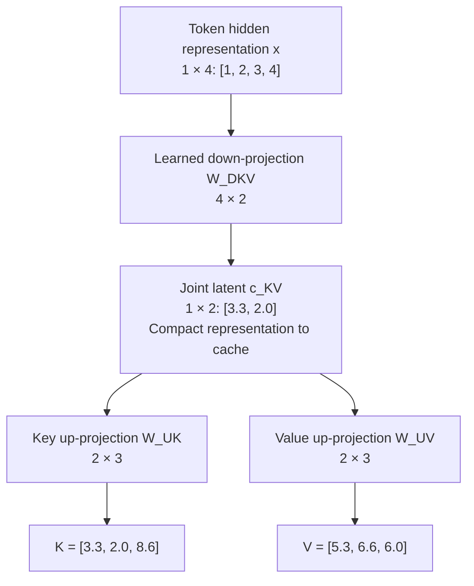
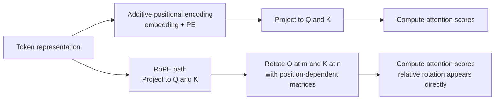
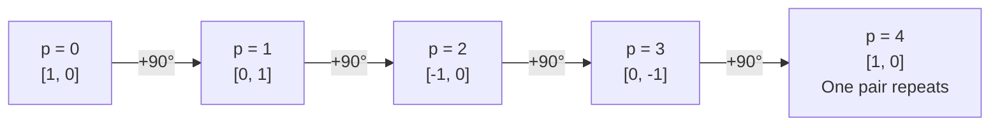
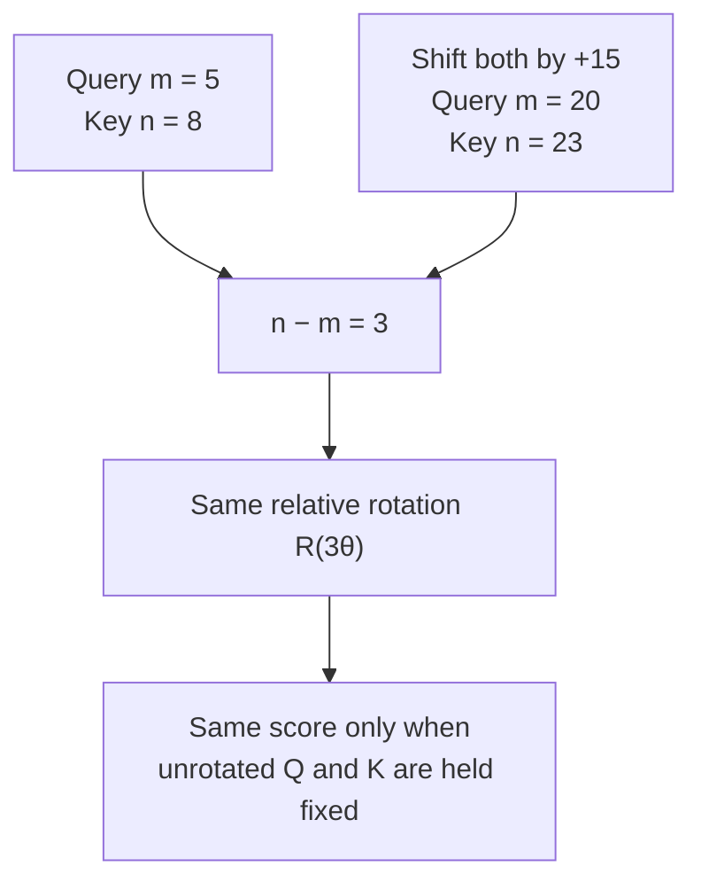

# Class 22: Multi-Head Latent Attention and Rotary Position Embeddings
### Production AI / LLM Engineering | Krish Naik Academy

**Mentor:** Sourangshu Pal (Paul)  
**Duration:** 3 hours 8 minutes 57 seconds | **Session:** Class 22 — 10 October 2026  
**Recording:** [10 Oct Kv cache](https://learn.krishnaikacademy.com/web/courses/6a16f8935e281281cd6b1128?chapter=6acb1140f293dfc747c00899)

---

## Quick Updates

This class continues the previous session's attention variants. Its actual focus is **MLA's learned latent compression and expansion**, followed by **RoPE's geometry and relative-position derivation**. It does not complete the full DeepSeek MLA–RoPE integration.

The instructor's [MLA / RoPE resource page](https://krishnaikacademy.notion.site/MLA-ROPE-3f6eba9593d080189571ceade0f43c17) supplies the 20-page handwritten [MLA rope .pdf](https://drive.google.com/file/d/1ZpgNtvbHywljgB5B2WeK3CjV684FB4uq/view?usp=sharing), the DeepSeek-V2 and RoFormer papers, and two simulators. The recording's own Resources tab supplies the transcript; the PDF is linked through the course hub. The diagrams below translate the PDF's projections, encoding paths, rotation cycle, and relative-position examples into editable study diagrams.

Paul confirmed that practical notebooks had already been shared with the previous class. Matching material is in the [KV cache and attention variants repository](https://github.com/sourangshupal/kv-cache-attention-variants/tree/main), especially `06_mla.ipynb` and `07_rope.ipynb`. These are companion resources; their saved outputs are not new results measured in this recording.

A class poll ended at approximately **53% for RAG and 47% for fine-tuning** as the next substantial module. Paul proposed starting the RAG framework material, with Divesh handling four classes during his announced absence, then completing that module before returning to fine-tuning. The sequence remained a course plan. He also requested feedback on a separate draft application-oriented syllabus; it was not a finalized addition to this class.

---

## Recap: Count Cached Values, Not Tokens

The memory comparison starts with **eight query heads**, each with **head width 64**. Query-head count stays the same while the number or form of cached key/value representations changes.

| Attention form | Cached key values per token, per layer | Cached value values per token, per layer | Total cached scalar values |
|---|---:|---:|---:|
| MHA: eight KV heads | 8 × 64 = 512 | 8 × 64 = 512 | **1,024** |
| MQA: one shared KV head | 64 | 64 | **128** |
| GQA: four KV heads | 4 × 64 = 256 | 4 × 64 = 256 | **512** |
| Simplified MLA example: latent width 64 | Joint latent representation | Included in that same latent | **64**, before any separate positional-key component |

These numbers are dimensions or stored scalar elements, not numbers of tokens. MHA's combined baseline is 1,024; comparing its key-only width of 512 with MQA's combined 128 would mix two accounting conventions.

For GQA, each pair of query heads shares one KV head. MQA shares one KV head across all eight queries. The query projections can still differ, so sharing keys does not force identical attention scores. Paul used **attention diversity** to explain the expressive tradeoff: independently learned KV heads offer different representations, whereas sharing reduces that freedom.

This is not an accuracy ranking that holds for every model. A cache reduction does not directly measure lost answer quality. The architecture, training procedure, task, and evaluation determine whether the tradeoff is useful.

MLA changes the question. Instead of asking how many full KV heads to retain, it asks whether a compact learned vector can carry the information needed to produce the key and value representations. Many query heads can use that shared latent without storing a full key and value for every head.

The class's 64-value MLA row is deliberately simplified. It explains the compression idea; it is not the complete cache layout of a production DeepSeek model.

---

## MLA Down-Projection: A Learned Low-Rank Representation

Let a token's input to an attention layer be a hidden representation \(x\) of width \(d\). This is a numerical vector, not the token ID. At different layers it represents the token after the preceding computations.

The class uses a **row-vector convention**:

\[
x\in\mathbb{R}^{1\times d},\qquad
W_{DKV}\in\mathbb{R}^{d\times d_c},\qquad
c^{KV}=xW_{DKV}\in\mathbb{R}^{1\times d_c}.
\]

Here:

- \(D\) means **down-projection**.
- \(KV\) means the latent is used jointly for keys and values.
- \(d_c\) is the chosen latent width, usually much smaller than the expanded key/value width.
- \(W_{DKV}\) is learned through the model's training objective.

Paul first illustrated an eight-number input compressed to three numbers. The required matrix shape is \(8\times3\): the inner dimensions match, and the resulting row vector has three entries.

\[
(1\times8)(8\times3)=(1\times3).
\]

The output width is an architectural choice. The entries of the matrix are learned parameters. These are different decisions: training learns the values within a shape that the architecture has specified.

### Worked compression: four values become two

The whiteboard then uses:

\[
x=[1,2,3,4],\qquad
W_{DKV}=\begin{bmatrix}
0.1&0.2\\
0.3&0.1\\
0.2&0.4\\
0.5&0.1
\end{bmatrix}.
\]

The shapes are \(1\times4\) and \(4\times2\), so the latent contains two values. Each output entry is a dot product with one matrix column:

\[
\begin{aligned}
c_1&=1(0.1)+2(0.3)+3(0.2)+4(0.5)\\
   &=0.1+0.6+0.6+2.0=3.3,\\
c_2&=1(0.2)+2(0.1)+3(0.4)+4(0.1)\\
   &=0.2+0.2+1.2+0.4=2.0.
\end{aligned}
\]

Therefore:

\[
\boxed{c^{KV}=[3.3,2.0].}
\]

These small weights were selected to make the arithmetic visible. They are not a trained checkpoint, a measured embedding, or evidence of a particular model's compression quality.

### Why the class calls this lossy compression

A map from four unconstrained numbers to two generally discards information. Different inputs can produce the same latent. Increasing the number of output coordinates later cannot recover information that the latent did not retain.

The useful goal is therefore not to reconstruct every original coordinate perfectly. Training should make the latent retain information that is useful for the downstream attention and language-model objective. A low-rank bottleneck limits representational capacity, but the task impact must be evaluated; it cannot be inferred by equating a percentage reduction in dimensions with the same percentage reduction in quality.

---

## Separate Up-Projections Produce Keys and Values

The compressed latent branches into **two learned maps**:

\[
K=c^{KV}W_{UK},\qquad V=c^{KV}W_{UV}.
\]

\(U\) means **up-projection**. The notation \(W_{UV}\) is used consistently here for the value up-projection; some live annotations used a different ordering of the letters.

If the latent has two entries and an expanded vector needs three entries, each up-projection has shape \(2\times3\). If the required output width were ten, its shape would be \(2\times10\). Expanding the coordinate count is not an inverse operation that magically restores the original information.



This follows the branching sketch on PDF pages 4–6. The summary page contains a down-projection shape typo; the explicit matrix and arithmetic establish \(4\times2\), as shown above.

### Key expansion

The supplied key expansion matrix is:

\[
W_{UK}=\begin{bmatrix}1&0&2\\0&1&1\end{bmatrix}.
\]

Multiplying the latent by its columns gives:

\[
\begin{aligned}
K_1&=3.3(1)+2.0(0)=3.3,\\
K_2&=3.3(0)+2.0(1)=2.0,\\
K_3&=3.3(2)+2.0(1)=8.6.
\end{aligned}
\]

Thus \(K=[3.3,2.0,8.6]\).

### Value expansion

The value matrix is separate:

\[
W_{UV}=\begin{bmatrix}1&2&0\\1&0&3\end{bmatrix}.
\]

Therefore:

\[
\begin{aligned}
V_1&=3.3(1)+2.0(1)=5.3,\\
V_2&=3.3(2)+2.0(0)=6.6,\\
V_3&=3.3(0)+2.0(3)=6.0.
\end{aligned}
\]

So \(V=[5.3,6.6,6.0]\), matching the final whiteboard result and the answers students supplied in chat.

The zeros in these teaching matrices do not impose a zero or diagonal matrix structure on MLA. The learned matrices can be dense. Key and value projections have separate parameters; the model does not require their entries to match.

The word **decompression** is a useful classroom analogy. More precisely, this architecture *defines* its keys and values through learned up-projections from a latent. It need not first build ordinary full MHA keys and values and then compress those already materialized tensors. Likewise, the expanded key or value width need not equal the hidden-state width in every architecture; it must match the attention design's required shapes.

---

## Persistent Cache Savings and Inference Work

Paul's next toy example stores six combined key/value scalar values per token without MLA and two latent values with MLA:

| Toy representation | Values per token | Tokens | Total stored values |
|---|---:|---:|---:|
| Expanded K and V | 6 | 1,000 | 6,000 |
| Joint latent | 2 | 1,000 | 2,000 |

This is a **threefold reduction** in stored values, or about **66.7% fewer**. The six already counts the combined representation, so it should not be doubled again. It is also not an assertion that six full heads require only six scalar values.

For ordinary MHA/MQA/GQA, persistent cache bytes are obtained from:

\[
\text{bytes}=2BH_{KV}d_hLTs,
\]

where \(B\) is batch size, \(H_{KV}\) the number of cached KV heads, \(d_h\) head width, \(L\) layers, \(T\) cached tokens, and \(s\) bytes per element. The leading two counts K and V.

A joint latent is already one representation used for both. It does not inherit that leading two just because its name contains “KV.” For the simplified latent-only case, the corresponding count is \(BTLd_cs\). A positional-key cache, when present, must be counted separately.

### Learned during training does not mean computed only during training

Several chat questions asked whether expansion consumes memory and repeated matrix multiplication undermines the savings. Distinguish three things:

1. **Parameters:** learned projection matrices, reused after training.
2. **Activations:** token-dependent latent, query, key, and value representations computed when processing inputs.
3. **Persistent cache:** the tensors retained across successive decode steps.

MLA also operates during inference. Every new token needs its token-dependent latent representation. A straightforward implementation can reconstruct expanded keys and values at attention time, which consumes computation and temporary memory. Keeping the latent as the persistent cache still saves storage between steps.

An optimized implementation can reorganize projection algebra to avoid explicitly expanding the full historical KV tensors. The DeepSeek-V2 paper describes absorbing the key up-projection into the query-side computation and the value up-projection into the output-side computation. This optimization, rather than the mere fact that weights are pretrained, explains how explicit reconstruction may be avoided. [DeepSeek-V2, low-rank KV compression](https://arxiv.org/html/2405.04434v5#S2.SS1.SSS2).

There was no runtime or memory benchmark in this class establishing the cost of those alternatives. The dimensional examples show storage accounting, not a measured latency result.

### Exact companion projection declarations

The instructor repository's [MLA implementation](https://github.com/sourangshupal/kv-cache-attention-variants/blob/main/src/kv_cache_variants/attention/mla.py) declares the three KV-side projections as follows. This is an exact excerpt from its class initializer, not independently reconstructed lecture code:

```python
self.kv_down_proj = nn.Linear(d_model, latent_dim, bias=False)
self.k_up_proj = nn.Linear(latent_dim, num_heads * self.head_dim, bias=False)
self.v_up_proj = nn.Linear(latent_dim, num_heads * self.head_dim, bias=False)
```

PyTorch's linear layer expresses input and output widths through those arguments. The module additionally contains query, positional, and output projections. Thus “three matrices” describes the simplified KV compression/expansion path, not the total number of learned matrices in a complete attention layer.

---

## Reading the DeepSeek-V2 Diagram Without Expanding the Lesson's Scope

Paul opened [DeepSeek-V2](https://arxiv.org/pdf/2405.04434) to connect the classroom notation to the research architecture. The key phrase is **low-rank key-value joint compression**.

The paper uses column vectors, so its down-projection is written \(c_t^{KV}=W^{DKV}h_t\). This is the same shape-compatible idea as the class's row-vector \(xW_{DKV}\), with transposed matrix conventions. The subscript \(t\) identifies a token position; it does not change the basic compression mechanism.

The discussion also identified query compression, a separate rotary path, and MoE in the architecture diagram. Query compression can reduce training activations without reducing the historical KV cache. MoE was only pointed out, not taught. With decoupled RoPE, the paper's cache includes **both the latent and a positional key**, giving \((d_c+d_h^R)L\) elements per token across layers. The latent-only whiteboard total therefore omits a real production component. [DeepSeek-V2, MLA architecture](https://arxiv.org/html/2405.04434v5#S2.SS1).

At the end Paul explicitly postponed the full content/NoPE and rotary-path combination. “NoPE” here labels the content portion without rotary position encoding; it does not mean the complete model has no positional information. The complete branch algebra, query compression, and optimized integration belong to the announced next discussion.

---

## Positional Encoding Recap: Why Content Alone Is Insufficient

Before deriving RoPE, Paul returned to the original Transformer. Token order changes grammar, meaning, and programming-language structure. A content-only attention operation has no explicit position coordinate telling it where a token occurs.

More precisely, self-attention without positional information or an order-dependent mask is **permutation equivariant**: permuting the input rows permutes the corresponding output rows. Calling it “order blind” conveys the classroom intuition, but calling the entire output permutation invariant would be imprecise. A causal mask adds ordering constraints; it is not the same mechanism as a positional representation.

In the original additive approach, positional information has the same width as the token embedding:

\[
z_p=e_p+PE_p.
\]

The elementwise sum keeps width \(d_{model}\). There is no need to append more coordinates simply to add the positional vector.

### Sine/cosine pairs

The formulas shown in the PDF are:

\[
PE(p,2i)=\sin\left(\frac{p}{10000^{2i/d_{model}}}\right),\qquad
PE(p,2i+1)=\cos\left(\frac{p}{10000^{2i/d_{model}}}\right).
\]

\(p\) is token position, such as 0, 1, 2, and so on. \(i\) indexes a dimension pair; it is not another token position. Pair \(i=0\) occupies coordinates 0 and 1, pair \(i=1\) occupies 2 and 3, and so forth.

For \(d_{model}=4\), the positional vector has two sine/cosine pairs. The different denominators give the pairs different frequencies. Position can continue beyond 3; the model width of four does not limit the sequence to four tokens.

A unit circle makes the trigonometry concrete. The point \((\cos\alpha,\sin\alpha)\) has unit radius, while the two coordinate values lie between −1 and 1. The sine/cosine pair in the additive encoding is related to this picture, but adding that pair to an embedding is not itself a rotation of the embedding.

### Separate the actual limitations

The class discussed long-context generalization, whether relative distances are explicit, extra parameters, and modification of the original embedding. Keep these distinctions clear:

- **Fixed sinusoidal encodings have no learned positional parameters.** Learned positional embedding tables do. Their parameter cost cannot be attributed to the fixed sine/cosine formula.
- **A sinusoidal formula can be evaluated beyond the training length.** That mathematical availability does not guarantee reliable model behavior on much longer inputs.
- **Relative-position structure is not wholly absent from sinusoidal encodings.** The original paper describes fixed offsets as linear transformations of its encodings. RoPE gives a particularly direct relative-position form inside the query/key dot product.
- **Additive position information is structured signal.** It changes the content representation, but that alone does not make it random noise or establish that it harms a model.

These qualifications are consistent with the original paper's distinction between fixed and learned choices and its stated motivation for sinusoidal encodings. [Attention Is All You Need, positional encoding](https://arxiv.org/html/1706.03762v7#S3.SS5).

Adding position before the query/key projections also influences their resulting values: \(W_Q(e+PE)\) and \(W_K(e+PE)\) both depend on \(PE\). RoPE changes *how* that information enters the attention score; it does not establish that additive positional information had no connection to queries and keys.

---

## RoPE: Rotate the Projected Query and Key

**RoPE** means **Rotary Position Embedding**. The main change is from adding a positional vector at the embedding input to applying position-dependent rotations to query and key vectors.

Using column vectors for the rotation derivation:

\[
q_m=W_Qx_m,\qquad k_n=W_Kx_n,
\]

then:

\[
q'_m=R_mq_m,\qquad k'_n=R_nk_n.
\]

\(m\) is the query's position and \(n\) the key's position. They can differ. The prime marks the vector after rotation. Standard RoPE applies these rotations to Q and K; V is used in the weighted-value aggregation that follows score calculation.



This translates the contrast drawn on PDF pages 9–12. Both paths are ways of conveying order. RoPE also adds an operation, so its motivation is not simply removing all positional computation.

### Start with ordinary 2D rotation

For a column vector \(x=[x_1,x_2]^T\), the counterclockwise rotation matrix is:

\[
R(\alpha)=\begin{bmatrix}
\cos\alpha&-\sin\alpha\\
\sin\alpha&\cos\alpha
\end{bmatrix}.
\]

Multiplication gives:

\[
\begin{aligned}
x'_1&=x_1\cos\alpha-x_2\sin\alpha,\\
x'_2&=x_1\sin\alpha+x_2\cos\alpha.
\end{aligned}
\]

The sign pattern matters: it makes this an orthogonal rotation that preserves vector length. Arbitrarily changing entries can create a different transformation, including one that stretches the vector. Other consistent conventions, such as using the negative angle, rotate clockwise instead.

In the class's shorthand, each position adds a fixed angular increment \(\theta\):

\[
\alpha_p=p\theta,\qquad R_p=R(p\theta).
\]

Position zero gives \(R(0)=I\), the identity matrix. It adds no positional rotation. This does not require the original query to point along the positive x-axis.

### The 90-degree teaching example

Paul chose \(q=[1,0]^T\) and \(\theta=90^\circ\) to make the results easy to compute:

| Position \(p\) | Added angle \(p\theta\) | Rotated vector \(R_pq\) |
|---:|---:|---|
| 0 | 0° | \([1,0]^T\) |
| 1 | 90° | \([0,1]^T\) |
| 2 | 180° | \([-1,0]^T\) |
| 3 | 270° | \([0,-1]^T\) |
| 4 | 360° | \([1,0]^T\) |
| 5 | 450° | \([0,1]^T\) |



This is the sequence on PDF pages 13–15. The first token is numbered zero, the second one, and so forth. The angle is proportional to position; the integer position and the angle are not interchangeable physical quantities.

For code, trigonometric functions ordinarily take **radians**. \(\pi\) radians equals 180°, and \(\pi/2\) equals 90°. Avoid mixing degrees and radians in one expression.

### Exact companion rotation example

Cell 3 of the instructor's [RoPE notebook](https://github.com/sourangshupal/kv-cache-attention-variants/blob/main/teaching_notebooks/07_rope.ipynb) uses 30°, rather than the live whiteboard's 90°:

```python
import math
import torch

# Hand-rotate a single 2D vector by 30 degrees, by hand, then verify with torch.
angle = math.radians(30)
v = torch.tensor([1.0, 0.0])
rotation_matrix = torch.tensor([
    [math.cos(angle), -math.sin(angle)],
    [math.sin(angle), math.cos(angle)],
])
rotated = rotation_matrix @ v
print("original vector:", v.tolist())
print("rotated 30 degrees:", rotated.tolist())
print("norm preserved:", torch.allclose(v.norm(), rotated.norm(), atol=1e-6))
```

Its saved output is approximately \([0.8660254,0.5]\), with `norm preserved: True`. This is a supplied notebook result, not a job rerun while preparing these notes. It illustrates the same rotation rule with an angle whose cosine is nonzero.

---

## Derivation: The Dot Product Exposes Relative Position

The central result comes from rotating both operands before taking their dot product. The class first omitted softmax and V to isolate this first attention operation. Retaining the usual scale factor, the score is:

\[
s_{mn}=\frac{(R_mq_m)^T(R_nk_n)}{\sqrt{d_k}}.
\]

Here \(d_k\) is the width of the participating query/key vectors. A consistent vector convention matters: \(q^Tk\) is the scalar inner product for column vectors. For row-vector batches the corresponding matrix expression uses \(QK^T\).

### Step 1: Transposing a product reverses its order

\[
(AB)^T=B^TA^T.
\]

Thus:

\[
(R_mq_m)^T=q_m^TR_m^T,
\]

and the score becomes:

\[
s_{mn}=\frac{q_m^TR_m^TR_nk_n}{\sqrt{d_k}}.
\]

This is a rewrite of the same scalar, not a new approximation.

### Step 2: Transpose reverses a rotation

For the orthogonal planar rotation used here:

\[
R(\alpha)^T=R(\alpha)^{-1}=R(-\alpha).
\]

The cosine entries remain the same and the sine entries change signs. Therefore \(R_m^T=R_{-m}\), where the shorthand continues to mean multiplication of the position index by the same frequency.

The negative subscript is a reverse-angle rotation. It does not denote a negative token index that the model must look up.

### Step 3: Compose rotations by adding their angles

For rotations in the same 2D plane:

\[
R(\alpha)R(\beta)=R(\alpha+\beta).
\]

Applying this to the two position angles:

\[
R_m^TR_n=R(-m\theta)R(n\theta)=R((n-m)\theta)=R_{n-m}.
\]

Consequently:

\[
\boxed{s_{mn}=\frac{q_m^TR_{n-m}k_n}{\sqrt{d_k}}.}
\]

The rotation in the score now depends on the **relative offset \(n-m\)**. The score still depends on query and key content. It is not simply the integer gap, and the dot product does not output a separately decoded distance field.

The composition rule is for these compatible rotations, extended pair by pair with matching frequencies. It is not a claim that arbitrary matrices commute or that every 3D rotation can be combined by adding two scalar angles.

### Worked relative-position examples

The PDF gives two pairs:

| Query position \(m\) | Key position \(n\) | Offset \(n-m\) | Relative rotation |
|---:|---:|---:|---|
| 5 | 8 | 3 | \(R(3\theta)\) |
| 20 | 23 | 3 | \(R(3\theta)\) |

Both pairs are three positions apart. If their unrotated query and key content vectors are held fixed, the same relative rotation produces the same positional contribution to the score. Real tokens at those positions can have different content vectors, so their full attention scores need not be equal.



This translates PDF pages 18–19. In a causal decoder, a key at \(n>m\) is a future token and is masked. The class examples isolate rotation algebra; they do not override causality. The same argument works for allowed past-token offsets and for bidirectional attention.

At \(m=n\), the relative rotation is \(R_0=I\), leaving \(q_m^Tk_m/\sqrt{d_k}\). That means the positional rotation cancels for the same position. It does not require the query and key vectors to be identical, or guarantee the largest attention weight.

A shared shift also preserves every gap: \((n+a)-(m+a)=n-m\). This is the mathematical reason a window-shift simulator can preserve a positional scoring pattern when the underlying content vectors stay fixed.

---

## Frequencies, Periodicity, and Long-Range Relationships

The 90° example intentionally repeats after four steps. Shantanu and Abhishek asked about repetition and overlap. A single rotating pair cannot uniquely distinguish an unlimited sequence: 90° and 450° yield the same sine and cosine.

Real RoPE uses **many 2D pairs with different frequencies**. Each pair has its own angular increment \(\theta_i\), and position \(p\) supplies angle \(p\theta_i\). The paper's conventional schedule is geometric, with larger pair indices rotating more slowly. These multiple angular scales mitigate the ambiguity of using only one pair. [RoFormer, general RoPE form](https://arxiv.org/html/2104.09864v5#S3.SS2.SSS2).

The useful intuition is a clock with several hands. One hand repeats quickly; several hands together convey position over a wider range. This does not prove infinite unique positional resolution, remove finite-precision effects, or guarantee model accuracy beyond the training distribution.

| Frequency within a dimension pair | Change for one additional token | Useful intuition |
|---|---|---|
| Higher frequency | Larger angular change | Fine distinctions among nearby offsets |
| Lower frequency | Smaller angular change | Coarser variation across longer offsets |

The frequency is associated with the pair, **not chosen anew because two particular tokens are far apart**. At a fixed frequency, the angular increment per token is constant. A distant pair has a larger accumulated relative phase modulo a full turn; distance does not itself slow the rotation.

This makes the class's “fast/local, slow/long-range” explanation precise. Both fast and slow channels coexist in the representation. They allow the network to use multiple scales when learning positional relationships.

### Longer sequences remain an empirical challenge

Mangesh asked how rotating a token at position 1 relative to one at 100 or 300 solves the long-sequence problem. RoPE makes relative offset enter the score directly. That does not establish that any pretrained model will handle arbitrary unseen distances well.

Computing an angle at a new position and obtaining useful language-model behavior at that position are different achievements. The context-extension literature explicitly studies problems caused by extrapolating RoPE-based models beyond their trained context. Position Interpolation is one documented response; its algorithm was not taught in this recording. [Position Interpolation paper](https://arxiv.org/abs/2306.15595).

The companion RoPE notebook goes further into linear scaling, dynamic NTK, and YaRN. Those cells are supplementary reading, not evidence that this class delivered their algorithms. Its saved plot is an illustrative cosine trace, not a quality benchmark; it labels column zero as a lowest-frequency dimension even though the supplied frequency schedule makes that the highest-frequency pair. Do not use that label to infer the wrong ordering.

---

## Using the Simulators Without Confusing Content and Position

Paul shared [PlayPlain's playable RoPE](https://playplain.com/rope/) and the [MySimulator Transformer visualization](https://www.mysimulator.uk/ai-ml/transformer-architecture). Students used the displays to connect matrix operations with moving arrows.

### What the content-angle slider represents

Murtuza noticed that a simulator exposed both position and a **content angle**. He asked what controls the latter, whether it must change with position, and whether it is something a model designer must assume.

The distinction is:

- The unrotated query/key pair already has a direction determined by its numerical content.
- Position contributes an additional rotation \(p\theta_i\).
- A simulator can expose the original direction as a content-angle slider so that both effects are visible.

For a 2D vector whose starting direction is \(\phi\), the resulting direction is \(\phi+p\theta\). At position zero, the added rotation is zero, while the original direction can still be nonzero. In the classroom vector \([1,0]^T\), the content direction happened to be zero because that particular vector lies on the positive x-axis.

PlayPlain explicitly describes its content slider as the direction of the original query slice and its position slider as the extra rotation. It is a visualization control, not an additional standard learned RoPE parameter. [PlayPlain, one-token demonstration](https://playplain.com/rope/).

Paul redirected Murtuza to the other simulator, whose query/key-position controls made the intended positional comparison clearer. The practical response is to hold the content vectors fixed while changing positions, then separately vary content to see that a score depends on both.

### What to watch when moving query and key positions

Mangesh's follow-up kept sequence length constant, moved the query, then moved the key closer to it. The changing separation alters \(n-m\), which changes the relative rotation in the score. Two arrows becoming visually close is not, by itself, proof of a learned semantic relationship.

For study, use three controlled comparisons:

1. Hold content fixed and change only the key position: observe the changing offset and phase.
2. Shift both positions by the same amount: the relative phase should stay the same.
3. Place them at the same position: the added relative rotation becomes the identity.

During preparation, MySimulator's landing page still listed sequence length, query token, key token, frequency band, window-shift offset, and auto-shift controls, but its embedded simulation returned a 404. Its live behavior could therefore not be reproduced during this review. The classroom demonstration described here comes from the transcript; PlayPlain remains the other supplied visualization.

Changing the number of displayed tokens changes the available positions. It does not automatically retrain a model, validate a larger supported context, or measure long-document comprehension. Likewise, a display's “window shift” is a positional visualization; it should not be interpreted as a KV paging or eviction operation.

---

## Companion Code: Positional Tables and Decode Offsets

The instructor's [rope.py](https://github.com/sourangshupal/kv-cache-attention-variants/blob/main/src/kv_cache_variants/rope.py) makes the frequency/position calculation concrete. This exact excerpt builds the trigonometric tables:

```python
def build_rope_cache(
    head_dim: int, max_seq_len: int, base: float = 10000.0, device: torch.device | None = None
) -> tuple[Tensor, Tensor]:
    """Precompute cos/sin tables, shape (max_seq_len, head_dim)."""
    inv_freq = 1.0 / (base ** (torch.arange(0, head_dim, 2, device=device).float() / head_dim))
    positions = torch.arange(max_seq_len, device=device).float()
    freqs = torch.outer(positions, inv_freq)  # (seq, head_dim/2)
    emb = torch.cat([freqs, freqs], dim=-1)  # (seq, head_dim)
    return emb.cos(), emb.sin()
```

The cosine/sine table is sometimes called a “RoPE cache.” It is distinct from the persistent KV cache: one stores reusable positional factors, while the other stores token-dependent attention history.

The companion uses a split-half layout. `_rotate_half` pairs coordinates in the first half with corresponding coordinates in the second half:

```python
def _rotate_half(x: Tensor) -> Tensor:
    x1, x2 = x.chunk(2, dim=-1)
    return torch.cat([-x2, x1], dim=-1)
```

This is equivalent to organizing 2D pairs under a consistent coordinate permutation. It differs from writing adjacent pairs on the whiteboard. The table layout and rotation layout must agree; do not mix adjacent-pair code with these split-half factors without adapting the coordinate arrangement.

The rotation implementation selects position rows with an offset:

```python
def apply_rotary(x: Tensor, cos: Tensor, sin: Tensor, offset: int = 0) -> Tensor:
    """x: (batch, heads, seq, head_dim). cos/sin: (max_seq_len, head_dim) from build_rope_cache.

    offset lets you rotate a single new decode-step token by its true position
    (past_len) rather than always starting from 0.
    """
    seq = x.shape[2]
    c = cos[offset : offset + seq].to(x.dtype)
    s = sin[offset : offset + seq].to(x.dtype)
    return x * c + _rotate_half(x) * s
```

The notebook's saved single-token check compares `offset=seq_len` against rotating the entire extended sequence and selecting its last token. The stored result is `True`. This is a useful consistency check of positional indexing, not a language-model quality test.

### Limits of the supplied MLA demonstration

The [MLA notebook](https://github.com/sourangshupal/kv-cache-attention-variants/blob/main/teaching_notebooks/06_mla.ipynb) uses `d_model=32`, four heads, latent width eight, and positional-key width eight. Its saved outputs show a latent of shape `(1, 5, 8)` growing to `(1, 6, 8)` after a one-token step. The cache also includes the positional-key tensor; inspecting only the first tuple entry does not count all storage.

Its memory comparison passes `latent_dim + rope_dim` into the ordinary KV helper, which multiplies by two for separate K and V. That double-counts the joint latent-plus-positional-key layout. With 4,096 tokens and two bytes per element, the correct toy persistent storage for those two width-eight tensors is:

\[
4096(8+8)(2)=131072\text{ bytes}=128\text{ KiB per layer}.
\]

The saved notebook prints 256 “KB” for MLA because of that extra factor. This comparison assumes two bytes per cached element; it does not inspect the tensor dtype. The uncast teaching tensors use PyTorch's ordinary float32 default, which would require four bytes per element instead. [PyTorch default floating dtype](https://docs.pytorch.org/docs/stable/generated/torch.set_default_dtype.html). The ordinary MHA, GQA, and MQA rows use the helper's intended K/V accounting. Its formatter divides by 1,024, so the displayed units are binary-sized even though labeled KB. This correction follows inspection of the supplied [memory helper](https://github.com/sourangshupal/kv-cache-attention-variants/blob/main/src/kv_cache_variants/memory_calc.py) and cache tensors; it is arithmetic, not a new measurement.

The current educational implementation explicitly expands the cached latent to historical content keys and values. Its token-growth assertion checks cache length, not equality with a full-sequence attention result. It also uses a simplified query projection rather than the complete query-compression path of the paper. Read it as a learning implementation; the full production integration and its optimizations remain beyond this recording's delivered scope.

---

## What's Next

The closing plan prioritizes the **full MLA–RoPE combination**: content/NoPE and rotary portions, extra dimensions, and how DeepSeek's architecture combines them. Paul referred to subsequent DeepSeek variants while discussing that continuation.

He also named **FlashAttention** and **PyTorch SDPA**, followed by the remaining module wrap-up and **Kaplan/Chinchilla scaling laws**. Scaling laws were initially announced as the next class, but the closing discussion left MLA–RoPE integration and attention implementation topics still pending. This recording does not teach those scaling laws.

The RAG-versus-fine-tuning poll concerns the subsequent course sequence. LangChain/LlamaIndex, broader RAG work, fine-tuning algorithms, MoE, deployment, and kernel-related topics were discussed as future plans, not completed instruction here.

---

## Live Q&A Highlights

The table includes substantive in-class chat clarifications and the final open floor. Where source verification adds a necessary qualification, the answer uses the accurate formulation explained above. Chat-only names are retained as transcribed when their full identity is unavailable.

| Question | Answer |
|---|---|
| **Viraj Kumar / Pandya:** How are the compression and expansion weights determined? | They are learned during model training through the task loss and backpropagation. The toy entries were chosen for illustration; the matrix shapes are architecture choices. |
| **Nitin:** Are K and V expanded separately? | Yes. One joint latent feeds a key up-projection and a separate value up-projection. They have independent learned parameters. |
| **Participant transcribed as “Abundon”:** Is the key expansion a zero or diagonal matrix? | No. The zeros in the numerical example do not define a required matrix structure; the learned projection can be dense. |
| **Shantanu:** Does MLA happen only during training? | No. Its learned projections are also used in inference, and each token's latent representation is retained for subsequent decode steps. |
| **Gaurav:** Doesn't decompression take more memory? | Explicit expansion requires temporary activations. The persistent cache can still be compact; optimized implementations may avoid materializing full historical KV tensors. |
| **Nagesh, transcribed as “Nagish”:** What about repeated multiplication and inference cost? | Pretrained weights do not eliminate runtime matrix operations. Projection absorption can change the computation; this class did not benchmark the resulting latency. |
| **Murtuza, called “Murtaza” in chat:** Where do the latent values come from? | They are the output of applying the down-projection to the current token's hidden representation. They are not a fixed list shared by every token. |
| **Class calculation, with Thomas named:** How many learned matrices were introduced? | Three in the simplified KV path: one down-projection and two up-projections. The full attention module has other learned projections too. |
| **Class clarification:** Must expansion reproduce the input width? | The up-projection's output width follows the architecture's required K/V dimensions. Increasing its width does not restore discarded information. |
| **Viraj:** Can aggressive latent compression damage precise long-range information? | A tighter bottleneck can constrain useful information. The task impact must be evaluated; the session supplied no experiment establishing a universal quality loss or negligible impact. |
| **Recap clarification following Yogesh / Rahul / Sudhir responses:** Why inject position at all? | Token content alone does not explicitly identify order in ordinary content-only attention. The purpose is to supply positional structure, not merely assign greater importance to selected tokens. |
| **Class terminology clarification, with Rohit named:** What is RoPE's full form? | Rotary Position Embedding. It uses position-dependent rotations of query/key coordinates. |
| **Alok:** Will MLA use RoPE on top of its representation? | DeepSeek combines content and positional paths, but the complete integration was left for the next lesson. The simple latent-only example is not that complete architecture. |
| **Raj / Sai Maharana:** Why rotate Q and K rather than V? | Q and K form the attention scores, so rotating them makes positional relationships enter those scores. Values are aggregated after the weights are calculated. |
| **Jatinder, in chat:** Why change the earlier positional encoding approach? | The discussion focused on a direct relative-position form inside the dot product and long-context behavior. Fixed sinusoidal encodings still have useful structure; RoPE is not an automatic guarantee of unlimited context. |
| **Nitin:** Does RoPE remove an extra positional operation? | No. Rotation is itself an additional operation. The distinction is where and how position enters the score. |
| **Nitin, follow-up:** Were the positional-encoding issues caused by directly modifying the K/Q/V weight matrices? | Additive PE changes the input representation before projection; it is separate from changing learned weight matrices. The resulting projected vectors nevertheless depend on that positional input. |
| **Varsh, in chat:** Don't the added matrices increase trainable parameters? | Learned projection matrices do contribute parameters. That is separate from fixed sinusoidal or conventional fixed-frequency RoPE factors, which do not add learned positional tables. |
| **Sudhir, during the rotation example:** Why choose 90°? | It makes the demonstration easy to compute. Real RoPE uses dimension-pair frequencies; it does not assign 90° to every pair. |
| **Sudhir, late chat:** What does the negative subscript in \(R_{-m}\) mean? | It represents inverse rotation by the negative angle. For an orthogonal rotation, transposing the matrix reverses the rotation. |
| **Class clarification:** Why does the transpose disappear in the final expression? | \(R_m^T\) becomes \(R_{-m}\); composing it with \(R_n\) gives \(R_{n-m}\). The query transpose remains in the scalar dot product. |
| **Shantanu, transcribed as “Shantan Tala”:** Do angles eventually repeat? | Yes. Sine/cosine are periodic, so a single pair can repeat after a full turn. Multiple frequencies provide more positional structure than one rotating pair. |
| **Abhishek:** Will overlap occur, particularly with few dimensions? | A single-frequency representation aliases. Multiple pairs mitigate that ambiguity; overlap is not automatically random noise, and it does not establish infinite positional uniqueness. |
| **Abhishek, follow-up:** What if query and key have the same position? | Their relative rotary factor is the identity. Their content vectors can still differ, so the score is not necessarily maximal. |
| **Murtuza Saifee, open floor:** What controls the simulator's content angle? | It illustrates the original direction of the unrotated query/key slice. Position adds a separate angle; the content direction is not a standard extra RoPE parameter. |
| **Murtuza Saifee, follow-up:** Must content angle change when the position changes? | Not when isolating positional effects. Keep content fixed and vary position; the vector's initial direction and its added positional rotation are separate quantities. |
| **Murtuza Saifee, further clarification:** Does position zero mean content starts at zero degrees? | It means zero *additional rotation*. The class's \([1,0]^T\) has a zero-degree initial direction, but arbitrary learned content vectors need not. |
| **Mangesh Khandare, open floor:** How does RoPE help when tokens are 100 or 300 positions apart? | Relative offset enters the dot product directly. Reliable behavior at unseen long distances still requires appropriate model training or context-extension methods and evaluation. |
| **Mangesh Khandare, follow-up:** Is direction relevant to the rotation? | A sign convention determines clockwise versus counterclockwise rotation. The class uses the usual counterclockwise matrix; consistent Q/K conventions give the relative-offset property. |
| **Mangesh Khandare, simulator follow-up:** What does bringing query and key positions closer represent? | It changes their positional gap and therefore their relative phase. Visual closeness of arrows is not itself proof of semantic similarity or a model quality result. |
| **Mangesh Khandare, final follow-up:** What do sequence length and window shift show? | Sequence length determines the displayed positions. A shared window shift preserves gaps; it does not demonstrate retraining, larger validated model context, or KV-cache eviction. |
| **Sudhir Varanasi, open floor:** Will Colab exercises for MLA/MQA/GQA be shared? | Paul said the notebooks were already linked through the previous class's Notion resources. The matching instructor repository contains those teaching notebooks. |

---

## Key Pointers to Remember

- Count scalar values per token before converting to bytes; do not confuse dimensions with token count.
- MHA, MQA, and GQA reduce storage through different numbers of KV heads; MLA uses a compact learned latent.
- The class's worked latent is \([3.3,2.0]\), with expanded \(K=[3.3,2.0,8.6]\) and \(V=[5.3,6.6,6.0]\).
- Down-projection and up-projection are learned maps. Up-projection is not a general inverse of lossy compression.
- Learned parameters are reused during inference, while token-specific activations must still be computed.
- Persistent cache size, temporary activation memory, and runtime are separate quantities.
- A complete MLA cache can include a positional-key component in addition to the joint latent.
- Fixed sinusoidal PE adds no learned positional parameters and is not accurately described as random noise.
- RoPE rotates Q and K; position zero adds no rotation but does not force a zero content direction.
- The key identity is \(R_m^TR_n=R_{n-m}\), yielding \(q_m^TR_{n-m}k_n\).
- Equal gaps give equal positional rotations; equal full scores also require equal underlying content vectors.
- Fast and slow channels come from different dimension-pair frequencies, not distance-dependent changes in one pair's speed.
- Periodic trigonometry and relative offsets do not guarantee reliable inference at arbitrary context lengths.
- Full DeepSeek MLA–RoPE integration, FlashAttention, SDPA, and scaling laws remained future work.

---

## Action Items After Class 22

- [ ] Recompute both latent entries from the four-by-two compression matrix without looking at the answer.
- [ ] Expand the latent through both supplied matrices and check all six resulting K/V entries.
- [ ] Explain why a two-coordinate latent cannot generally recover every four-coordinate input exactly.
- [ ] Recalculate the 1,000-token example and distinguish stored values from bytes and head counts.
- [ ] Draw the three KV projection maps and separately label parameters, activations, and persistent cache.
- [ ] Read the MLA sections of DeepSeek-V2 and identify which components were deferred in this recording.
- [ ] Reproduce the 90° rotation cycle and convert the angles to radians before comparing it with code.
- [ ] Derive the relative-position identity using the product-transpose and rotation-composition rules.
- [ ] Use a simulator to hold content fixed, vary one position, and then shift both positions together.
- [ ] Inspect the companion notebook's stored outputs; distinguish cache-growth checks from numerical or quality validation.
- [ ] Review the supplied memory helper's extra factor of two before using it for a joint MLA cache.
- [ ] Keep context-extension notebook cells as supplementary reading until their algorithms are taught or independently studied.

---

*Compiled from the full Class 22 transcript, “10 Oct Kv cache,” Production AI / LLM Engineering, Krish Naik Academy. Original transcript: `GMT20261010-143237_Recording.cutfile.20261011043146773.transcript.vtt`; all eight parts and the final Q&A were read. All 20 pages of the course-linked `MLA rope .pdf` were visually inspected. Source recording and PDF links appear above.*

*Companion source review covered the complete current instructor-repository README, `06_mla.ipynb` (9 cells), `07_rope.ipynb` (11 cells, including saved outputs/plot), their corresponding documentation, and `mla.py`, `rope.py`, and `memory_calc.py`. Exact excerpts are labeled as companion code. The repository's current contents may differ from the live-session version; saved outputs were not independently rerun. Technical qualifications were checked against DeepSeek-V2, RoFormer, the original Transformer paper, Position Interpolation, and PlayPlain's own explanation. No model training, model API call, or GPU job was performed.*
