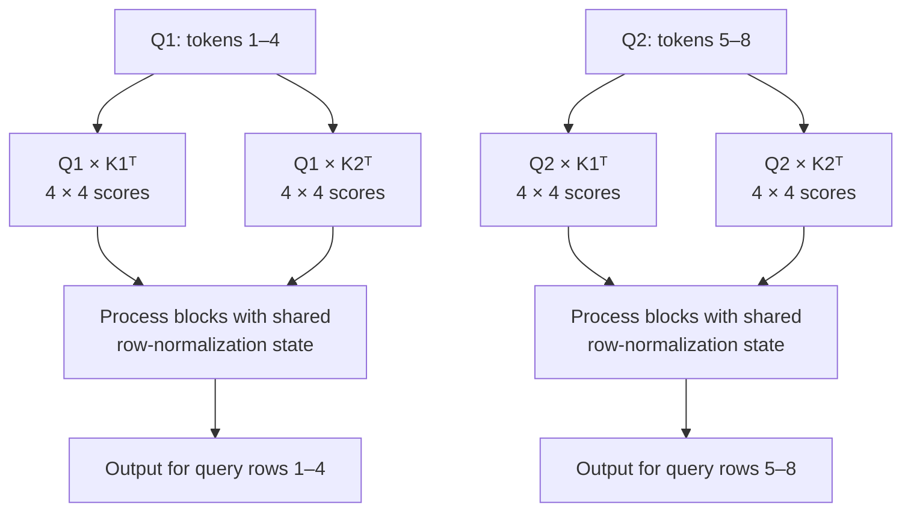
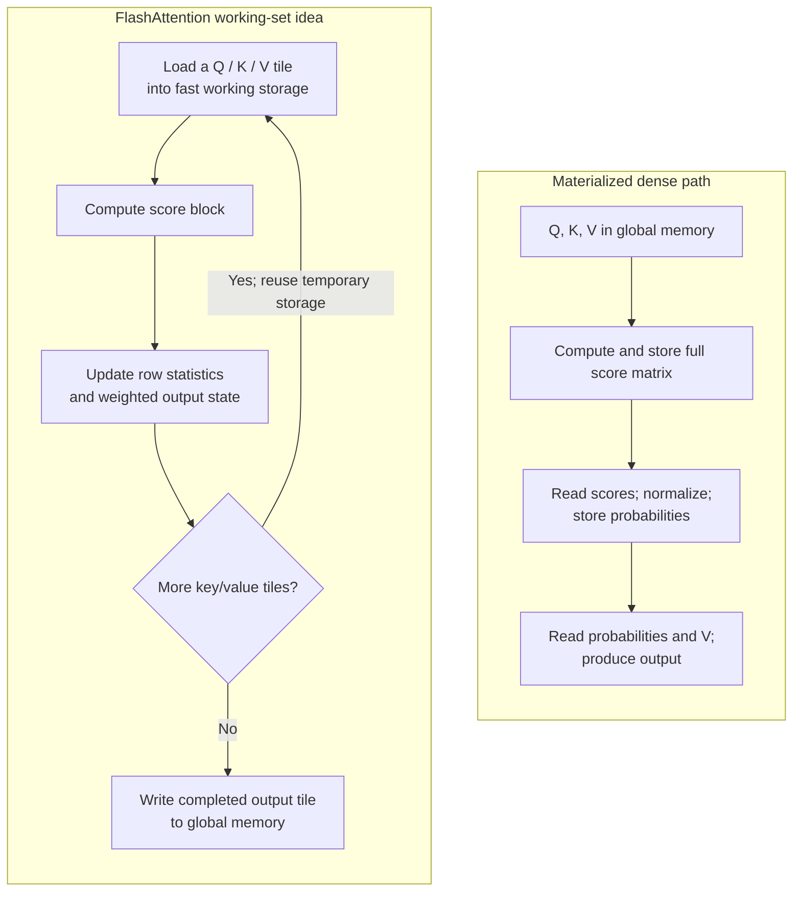
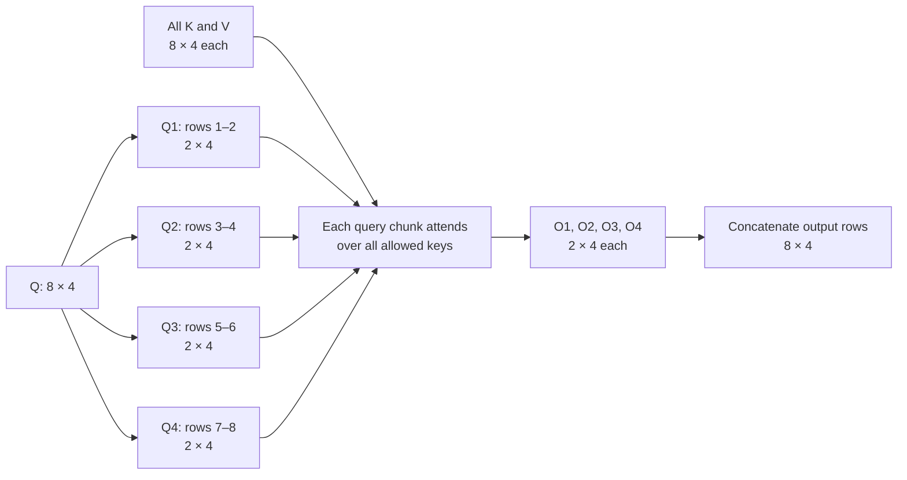
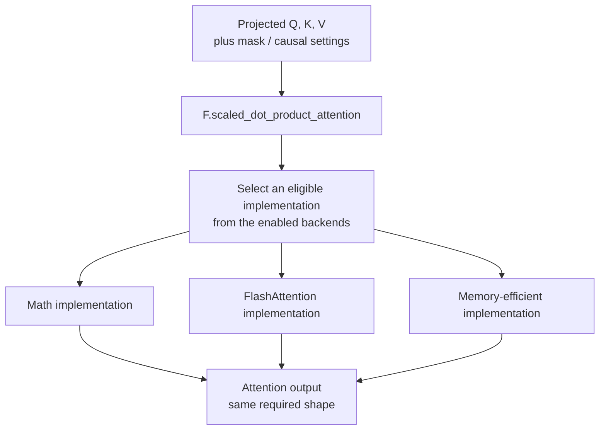

# Class 23: FlashAttention and PyTorch SDPA — Memory-Efficient Attention Execution
### Production AI / LLM Engineering | Krish Naik Academy

**Mentor:** Sourangshu Pal (Paul)  
**Duration:** 3 hours 2 minutes 9 seconds | **Session:** Class 23 — 17 October 2026  
**Recording:** [17 October class](https://learn.krishnaikacademy.com/web/courses/6a16f8935e281281cd6b1128?chapter=6ad3d4456f9687799d40e8c6)

---

## Quick Updates

The class covers **FlashAttention**, GPU memory traffic, **PyTorch's scaled dot product attention API**, and practical comparisons with manually implemented attention. Its goal is to execute the attention calculation with less intermediate storage and data movement while preserving its mathematical result.

The [FLASH / SDPA course resource page](https://krishnaikacademy.notion.site/FLASH-SDPA-3fdeba9593d08074a0eaeba63ab676fa) supplies the 13-page [FLASH & SDPA.pdf](https://drive.google.com/file/d/1SmAJcJad-ymfqZMXE99TUHAHVxF-tffi/view?usp=sharing) and the exact [FLASHATT notebook](https://colab.research.google.com/drive/1etkVdef6-JvnLzPBWAo1OBy22XF_3M-q?usp=sharing) and [SDPA notebook](https://colab.research.google.com/drive/1crIZV8jLxvF8uK-LvXydTmdB5g1qo0Tq?usp=sharing). Their saved cells and outputs resolve several approximate numbers spoken during the demonstration. Results below are supplied observations, not experiments rerun for these notes.

Paul also pushed missing notebooks to the existing [attention variants repository](https://github.com/sourangshupal/kv-cache-attention-variants/tree/main). He distinguished PagedAttention's previously discussed idea from the complete vLLM setup, which remained for deployment. No new full DeepSeek MLA–RoPE integration was worked through in this session.

Kaplan/Chinchilla scaling laws were announced for the next class. Following the earlier poll, LangChain and RAG were planned next, with Divesh teaching the initial framework classes. Fine-tuning and later modules would follow. These are the instructor's announced sequence, not topics implemented here.

---

## Which Problem Is Being Optimized?

The opening recap separated several complementary techniques:

| Technique | Main concern in this module |
|---|---|
| KV caching | Reuse previous token-dependent keys and values during generation |
| PagedAttention | Organize persistent KV storage in blocks and manage sharing/allocation |
| MQA / GQA | Reduce the number of distinct KV heads retained |
| MLA | Represent key/value information through a compact learned latent |
| FlashAttention | Execute attention while avoiding large materialized score/probability intermediates and reducing global-memory traffic |
| PyTorch SDPA | Expose an attention operation through an API that can dispatch to different implementations |

FlashAttention is an execution technique. It does not inherently replace a trained model's MHA with GQA, remove its learned projections, or improve its answer accuracy. Those are different design questions. It can be used alongside compatible attention architectures and caching strategies.

Paul repeatedly returned to **GPU traffic management**: a processor can have substantial arithmetic capacity yet spend time waiting for data. The attention computation must move inputs, intermediate values, and outputs through a memory hierarchy. Reducing this traffic can be as consequential as reducing arithmetic.

The first implementation distinction is therefore between the *mathematical operation* and the *way it is executed*. FlashAttention and an ordinary dense implementation can compute the same attention function while having very different temporary memory requirements.

---

## Why a Dense Attention Matrix Becomes Expensive

The familiar formula is:

\[
O=\operatorname{softmax}\left(\frac{QK^T}{\sqrt{d_k}}\right)V.
\]

Softmax normalizes over the key positions for each query row. An allowed-position mask can be included before normalization. In the initial noncausal examples, every query can compare with every key.

With `N` tokens, a single batch item and head produces an `N × N` score matrix. Eight tokens therefore produce 64 score entries. These are **score entries**, not a complete count of floating-point operations: forming each score also uses the query/key width.

For batch size `B`, head count `H`, and equal query/key lengths `N`, one materialized score tensor has:

\[
BH N^2\quad\text{elements},\qquad
BH N^2s\quad\text{bytes},
\]

where `s` is the number of bytes per stored element. FP16 uses two bytes; FP32 uses four.

### The class's batch-two, eight-head example

\[
2\times8\times1024\times1024=16{,}777{,}216\text{ elements}.
\]

That is **32 MiB in FP16** or **64 MiB in FP32** for one score tensor. The handwritten notes round these to approximately 32/64 MB. Binary units make the accounting exact.

Keeping batch and head counts fixed gives:

| Sequence length | One FP16 score tensor | One FP32 score tensor |
|---:|---:|---:|
| 1,024 | 32 MiB | 64 MiB |
| 2,048 | 128 MiB | 256 MiB |
| 4,096 | 512 MiB | 1 GiB |
| 8,192 | 2 GiB | 4 GiB |
| 32,768 | 32 GiB | 64 GiB |

Doubling the sequence length multiplies this score storage by four. The approximately 1 GiB FP32 example corresponds to length 4,096 under these settings, not length 1,024.

This table counts one intermediate tensor. Q/K/V, probabilities, final outputs, model parameters, gradients, optimizer state, and other activations can add further storage. A machine with enough capacity for the score tensor alone can still run out of memory during a real workload.

### Causal masking and decode are separate qualifications

Darshan asked whether attention should see fewer tokens. In a causal decoder, future positions are excluded. A straightforward dense implementation can nevertheless allocate an entire square tensor and then mask it. More efficient causal kernels can skip work on masked regions, while dense causal attention remains quadratic in sequence length asymptotically.

The square example describes a full sequence, as used in training or prompt processing. A single-token cached decode step has one query attending to an existing prefix, so its score shape is generally `1 × prefix_length` per head. It should not be assigned the same square score allocation as a full-sequence call.

Reducing precision changes the bytes per element; it does not remove the quadratic growth of the dense score tensor. Linear-attention architectures address a different algorithmic question. FlashAttention preserves ordinary softmax attention and changes its execution.

---

## Tiling: All the Relevant Interactions, a Smaller Working Set

Paul divided an eight-token example into two query blocks and two key/value blocks. `Q1` contains query rows 1–4 and `Q2` rows 5–8; the key and value blocks use the same token ranges.

The score blocks are:

\[
S_{11}=\frac{Q_1K_1^T}{\sqrt{d_k}},\quad
S_{12}=\frac{Q_1K_2^T}{\sqrt{d_k}},\quad
S_{21}=\frac{Q_2K_1^T}{\sqrt{d_k}},\quad
S_{22}=\frac{Q_2K_2^T}{\sqrt{d_k}}.
\]

Each is `4 × 4`, containing 16 scores. There are four blocks, so the total conceptual score count is still 64. Query block one must interact with both key blocks; restricting it to only `K1` would change the attention pattern.



This follows PDF pages 4–5. The blocks are a partition of the original interactions. The benefit comes from processing manageable blocks without keeping the entire score matrix resident as a separate global-memory object.

“Tiling” is not simply creating all four pieces and retaining them forever. That would preserve most of the original storage burden. A useful implementation computes a block, updates the required state, consumes its contribution to the output, and reuses its temporary space.

Likewise, avoiding the full matrix does not turn exact dense attention into a linear-time algorithm. The allowed query/key interactions still have to be computed. The savings concern intermediate storage, memory traffic, and a better organization of work.

---

## GPU Memory: Capacity, Bandwidth, and On-Chip Storage

The class used a high-level GPU diagram to explain why the location of an intermediate matters.

| Component | Role relevant to the lesson |
|---|---|
| GPU global memory | Holds large tensors, parameters, and other long-lived allocations; may use HBM or GDDR technology |
| SM: Streaming Multiprocessor | Executes groups of GPU threads and contains compute resources, registers, and shared-memory/cache resources |
| Registers | Very fast storage associated with executing threads |
| Shared memory / on-chip SRAM | Small, fast working storage used cooperatively by threads in a block |
| L1 and L2 caches | Help serve memory accesses; capacities, sharing, and organization depend on the architecture |
| CUDA/Tensor Core execution resources | Perform arithmetic; useful throughput also depends on supplying operands efficiently |

An SM is a processing unit, not another name for GPU RAM. NVIDIA's execution model is commonly described as **SIMT**, or single instruction, multiple threads. The SIMD comparison in the discussion provides intuition, but the two terms should not be treated as an identical hardware specification.

“HBM” means **high-bandwidth memory**. It is not a universal name for every GPU's VRAM. L4 uses GDDR6, while the H100 configuration discussed uses HBM. L4 is also a data-center product, so “enterprise GPU” does not by itself imply HBM.

The class compared an L4 with 24 GB and roughly 300 GB/s memory bandwidth against an H100 configuration with 80 GB and bandwidth in the TB/s range. NVIDIA lists L4's capacity/bandwidth in its [product specifications](https://www.nvidia.com/en-eu/data-center/l4/) and documents H100's memory and on-chip organization in the [Hopper tuning guide](https://docs.nvidia.com/cuda/hopper-tuning-guide/index.html). Exact H100 figures depend on its variant; the approximate table generated during class should not substitute for that variant's specifications.

**Capacity** says how much can be stored. **Bandwidth** says how quickly bytes can move. Neither is a direct measure of arithmetic operations per second. The purpose of the comparison was to identify a potential data-movement bottleneck, not to derive GPU speed from one number.

### What FlashAttention changes in the data flow

The ordinary multi-operation path can write the score tensor to global memory, read it for scaling/softmax, write probabilities, and read them again for multiplication with V. Fused tiled computation keeps smaller intermediates in fast storage and avoids these large materialized tensors.



The classroom walkthrough and companion notebook motivate this loop. It is a conceptual data-flow diagram, not a claim that every version uses one identical GPU scheduling order. Fewer global-memory transactions can help even if the full tensor would otherwise fit.

This also does not mean CUDA **Unified Memory** has been enabled. The SDPA discussion's “unified” idea is an API unifying attention implementations; CUDA Unified Memory is a separate memory-management facility.

---

## Online Softmax: Global Normalization from Incremental Updates

Tiling creates an important dependency: a query row's softmax denominator depends on **all allowed keys**, including keys in other blocks. Independently normalizing each small score block would give the wrong global probabilities.

The class returned to this several times, including Jatin's question and Murtaza's final clarification. The intended operation is one global row-wise softmax evaluated incrementally. “Online” describes updating sufficient state as blocks arrive; it does not mean internet access, and it is not defined by whether the kernel runs parallel work.

For one query row, the desired weighted output can be written as:

\[
o_i=\frac{\sum_j e^{s_{ij}}v_j}{\sum_j e^{s_{ij}}}.
\]

The key insight is that the implementation needs the correct normalization and weighted output, not an independently normalized probability matrix retained for every tile.

A numerically stable implementation maintains a running row maximum, a normalization sum in that maximum's scale, and a correspondingly scaled weighted-value accumulator. If a later block increases the maximum, earlier contributions must be rescaled before they are combined. This is the precise qualification behind the class's “running normalization,” “K statistics,” and “running output” language. [FlashAttention paper, algorithm and recomputation](https://arxiv.org/html/2205.14135).

Consequently:

- Contributions across **key blocks for one query row** are accumulated with compatible normalization.
- Completed outputs for **different query-row blocks** occupy different rows and can be assembled in order.
- Raw values `V1 + V2 + V3 + V4` are not the attention output by themselves; the contributions must be weighted by the correctly normalized scores.
- Discarding a temporary score block after its contribution has been incorporated is different from discarding the normalization state needed by later blocks.

The running state need not be a growing Python list of all scores. The purpose is to keep a small summary and output accumulator while avoiding the full quadratic intermediate.

FlashAttention and memory-efficient attention are not separated by one using correct global softmax and the other using an incorrect per-tile version. Both must preserve the chosen attention function. The lecture's tiling-versus-chunking distinction is useful for its examples, but it is not a universal definition of two different normalization functions.

Paul explicitly offered to work through the online-softmax formulas in more detail in the next class. This session established the conceptual running-state requirement; it did not deliver a complete numerical derivation of the stable recurrence.

### Backpropagation and parallel work

Abhishek asked about backward propagation. These attention implementations support training and gradients; changing the execution strategy does not remove backpropagation. The implementation can, however, differ substantially: FlashAttention recomputes intermediate blocks during backward to avoid retaining the large attention matrix. [FlashAttention, recomputation](https://arxiv.org/html/2205.14135).

Murtaza also asked whether the tiles must execute sequentially. GPUs can distribute work across batches, heads, query blocks, and other subdivisions. The original and later FlashAttention versions organize this parallel work differently. Calling the method online does not imply that the entire attention operation is a single serial loop. The [FlashAttention-2 paper](https://arxiv.org/abs/2307.08691) specifically studies better parallelism and work partitioning.

---

## Query Chunking: Follow the Shapes Through to the Output

The second whiteboard example starts with eight tokens and width four:

- Q: `8 × 4`
- K: `8 × 4`
- V: `8 × 4`

First split only the query rows into four chunks. Each `Qi` contains two tokens and therefore has shape `2 × 4`. Every chunk still attends to all eight keys.

For the first query chunk:

\[
S_1=\frac{Q_1K^T}{\sqrt{4}},\qquad
(2\times4)(4\times8)=2\times8.
\]

After row-wise softmax, `A1` still has shape `2 × 8`. Multiplication by V gives:

\[
O_1=A_1V,\qquad (2\times8)(8\times4)=2\times4.
\]

Repeat this for each query chunk and concatenate the **output rows**:

\[
O=\operatorname{Concat}_{rows}(O_1,O_2,O_3,O_4)\in\mathbb{R}^{8\times4}.
\]



This follows PDF pages 7–10. A working score block has 16 entries instead of 64, while all four chunks together still account for the original interactions. Concatenating all intermediate score blocks into a full retained matrix would undo that particular memory saving; the useful assembly is of the output rows.

The next example also splits K and V into four two-token chunks. Each query/key block product then has shape:

\[
(2\times4)(4\times2)=2\times2.
\]

For `Q1`, there are four such blocks, one for each key chunk, totaling 16 conceptual scores. Across four query chunks there are 16 block pairs and 64 scores. The corresponding V chunks each contribute to the output for that query chunk, under the global normalization discussed above.

PDF pages 11–12 show this `Q1 → K1/K2/K3/K4` structure and its repeated outputs. The small score blocks do not require a change in the final `8 × 4` output shape.

Query-only chunking and two-axis tiled execution are related ways to understand working-set size. PyTorch's SDPA API does not require the caller to implement this exact Python chunk loop or manually choose two-token tiles.

---

## SDPA Is an API with Multiple Implementations

The name **SDPA** is used in two ways:

1. The mathematical operation, scaled dot product attention.
2. PyTorch's `torch.nn.functional.scaled_dot_product_attention` API.

The API can select among implementations of the operation. It is not a synonym for only memory-efficient attention, and it is not an algorithm that must always differ from FlashAttention.

The class's main backend diagram has three branches:



This translates PDF page 13. These are the three implementations emphasized in the lesson. The framework also exposes other backend options, including cuDNN in the current API; the diagram is not a timeless exhaustive enumeration.

Automatic selection depends on device, dtype, shapes, masks, installed build, and backend eligibility. A forced-backend context restricts the choices. If the requested fused implementation cannot run and no suitable fallback is enabled, a call can fail; installing a Python package alone does not make unsupported hardware eligible. [PyTorch backend selection](https://docs.pytorch.org/docs/2.14/generated/torch.nn.attention.sdpa_kernel.html).

The math backend is a PyTorch implementation, not Python's `math` module calculating the whole attention operation. It is useful as a general fallback and reference. Its relative speed depends on the workload, so “nobody uses it” is not a sound implementation rule.

The GPU-specific CUDA FlashAttention kernel does not execute on a CPU. SDPA itself remains usable on supported non-CUDA devices through available implementations. A backend name or a successful API call should not be treated as a record that a particular CUDA kernel actually ran.

### Exact API wrapper from the class notebook

The supplied SDPA notebook defines:

```python
def sdpa_attention(query, key, value):
    return F.scaled_dot_product_attention(
        query,
        key,
        value,
        dropout_p=0.0
    )
```

This is the central practical change: pass the projected tensors to the library operation. The surrounding projection and head-combination logic still has its own role in a complete Transformer layer.

For causal attention, the same notebook provides this exact wrapper:

```python
def sdpa_causal_attention(query, key, value):
    return F.scaled_dot_product_attention(
        query,
        key,
        value,
        is_causal=True,
        dropout_p=0.0
    )
```

The saved square-sequence causal comparison reports `Outputs close: True`. The literal parameter is `is_causal`, rather than the transcription's occasional “casual.” For migrating custom code, match mask conventions: SDPA boolean `True` means a position participates, whereas some other attention interfaces use `True` to mean blocked. Also pass zero dropout explicitly for evaluation when appropriate; this functional API uses the supplied dropout probability. Floating-point fusion can produce small numerical differences across implementations. [PyTorch SDPA documentation](https://docs.pytorch.org/docs/2.14/generated/torch.nn.functional.scaled_dot_product_attention.html).

---

## Live Experiment One: Manual Attention versus Forced FlashAttention

The [FLASHATT notebook](https://colab.research.google.com/drive/1etkVdef6-JvnLzPBWAo1OBy22XF_3M-q?usp=sharing) records **PyTorch 2.11.0+cu130 on NVIDIA L4**. Its principal tensor setup is batch 1, eight heads, sequence length 2,048, head width 64, and FP16.

Paul initially tried the forced FlashAttention route on T4, encountered an unsupported execution, and changed the runtime to L4. That switch is part of the live debugging. The notebook's saved successful environment is L4.

The actual reference function is:

```python
def manual_attention(Q, K, V):
    scores = Q @ K.transpose(-2, -1)
    scores = scores / math.sqrt(Q.shape[-1])

    probabilities = torch.softmax(scores, dim=-1)

    output = probabilities @ V
    return output
```

The notebook also has separate scratch cells for individual operations. Those scratch cells omit the scaling division and should not be copied as a complete equivalent attention chain. The comparison uses the scaled function above.

The forced backend call is:

```python
import torch.nn.functional as F
from torch.nn.attention import sdpa_kernel, SDPBackend
```

```python
with torch.inference_mode():
    with sdpa_kernel(SDPBackend.FLASH_ATTENTION):
        output_flash = F.scaled_dot_product_attention(
            Q, K, V
        )

print("FlashAttention output:", output_flash.shape)
```

Both outputs have shape `(1, 8, 2048, 64)`. Shape equality is necessary, but does not prove numerical agreement; the next cell measures it:

| Saved comparison | Value |
|---|---:|
| Maximum absolute difference | 0.0003662109375 |
| Mean absolute difference | 0.0000152587890625 |
| `torch.allclose`, absolute/relative tolerances both `1e-2` | True |

These FP16 outputs agree within the chosen tolerance. They are not asserted to be bit-for-bit identical, and the chosen tolerance is part of the test's meaning.

### Timing the same operation

The supplied timing function warms up the callable, synchronizes CUDA before and after the measured loop, and reports milliseconds per call:

```python
def benchmark(fn, warmup=5, iterations=20):
    with torch.inference_mode():
        for _ in range(warmup):
            fn()

        torch.cuda.synchronize()
        start = time.perf_counter()

        for _ in range(iterations):
            fn()

        torch.cuda.synchronize()
        end = time.perf_counter()

    return (end - start) * 1000 / iterations
```

Synchronization matters because GPU work is asynchronous relative to ordinary Python timing. These are **forward attention-call timings**, not end-to-end model-generation or training-throughput measurements.

| Same L4 configuration | Saved latency |
|---|---:|
| Manual attention | 1.759 ms |
| Forced FlashAttention | 0.150 ms |
| Automatic SDPA | 0.145 ms |

The saved notebook reports an 11.75× manual/forced-flash speedup from its unrounded measurements. Automatic SDPA being close to the forced call does not establish which backend it selected. The small timing difference also does not demonstrate a distinct memory-efficient algorithm outperforming FlashAttention.

### Sequence length changes the result

The supplied sweep uses one batch item, eight heads, head width 64, and FP16:

| Sequence length | Manual latency | Forced FlashAttention latency | Saved speedup |
|---:|---:|---:|---:|
| 512 | 0.090 ms | 0.069 ms | 1.29× |
| 1,024 | 0.142 ms | 0.068 ms | 2.10× |
| 2,048 | 1.772 ms | 0.153 ms | 11.61× |
| 4,096 | 6.734 ms | 0.541 ms | 12.46× |

The saved plot displays the same widening gap. This supports the lesson that workload shape affects the payoff; it contradicts treating “about 10×” as an invariant. Milliseconds remain milliseconds throughout this table.

During the live session, attempting a much larger sequence produced an out-of-memory error. The transcript does not establish that the fused call itself was the failing allocation; the sweep executes the manual baseline too. The retained saved sweep ends at 4,096. That OOM is evidence of a limit encountered in the particular experiment, not a universal maximum sequence length.

---

## Memory Measurements: Read “Peak Additional” Literally

The FlashAttention notebook measures peak allocated tensor memory above an existing baseline:

```python
def peak_extra_memory(fn):
    torch.cuda.synchronize()
    torch.cuda.reset_peak_memory_stats()

    baseline = torch.cuda.memory_allocated()

    with torch.inference_mode():
        output = fn()
        torch.cuda.synchronize()
        peak = torch.cuda.max_memory_allocated()

    del output
    return (peak - baseline) / (1024 ** 2)
```

For the L4 FP16 configuration, its saved output is:

| Operation | Peak additional allocated memory |
|---|---:|
| Manual attention | 130.00 MiB |
| Forced FlashAttention | 2.06 MiB |

Use these values rather than the approximate 138 MB/2 MB phrasing in the transcript. The difference is substantial, but the fused operation is not using only 2.06 MiB of *total GPU memory*. Inputs and other existing allocations are already in the baseline, and allocator reservations, CUDA context memory, or a real model's parameters are different quantities. [PyTorch CUDA memory management](https://docs.pytorch.org/docs/2.14/notes/cuda.html#cuda-memory-management).

The output itself also takes storage. The useful result is that large temporary score/probability tensors need not dominate the additional allocation.

### The separate T4 SDPA experiment

The [SDPA notebook](https://colab.research.google.com/drive/1crIZV8jLxvF8uK-LvXydTmdB5g1qo0Tq?usp=sharing) records **PyTorch 2.11.0+cu130 on Tesla T4**. Its small correctness comparison uses `(2, 4, 128, 64)` tensors and reports maximum difference `5.960464477539062e-07` with `allclose` true at absolute/relative tolerance `1e-5`.

The saved long-sequence experiment then uses batch 2, eight heads, length **8,000**, width 64, and ordinary default floating-point tensors, rather than the first notebook's explicit FP16 setting.

| T4, long-sequence configuration | Saved result |
|---|---:|
| Manual latency | 162.410 ms |
| Automatic SDPA latency | 84.444 ms |
| Speedup | 1.92× |
| Manual peak additional memory | 7,844.50 MiB |
| Automatic SDPA peak additional memory | 32.00 MiB |

The notebook does not log which implementation automatic SDPA chose. It establishes that the API call ran and produced these saved measurements; it does not prove that T4 ran the same forced FlashAttention backend as the L4 example.

The transcript also describes earlier, shorter runs with smaller timing and memory figures. The saved notebook reflects the later 8,000-token setting. Keep these stages distinct rather than assigning a spoken short-run number to the final long-run configuration.

Nor should the two notebooks be used as a direct L4-versus-T4 or FlashAttention-versus-MEA ranking: hardware, precision, batch size, sequence length, and API restrictions differ. Each comparison is meaningful within its own recorded setup.

---

## Hardware Compatibility and the Separate Package Installation

The successful SDPA backend call and the attempted installation of the external **flash-attn** package are different integration routes. PyTorch's built-in supported implementation can run without a successful installation of that separate package.

The live installation was instructive because it did not become a completed external-package demonstration. The class investigated a slow C++/CUDA build, Ninja, host RAM usage, GPU/runtime changes, package versions, and suggested wheel files. The supplied installation output stops at **Building wheels**. The later `model_flash` generation and generation-benchmark cells have no saved successful outputs.

The official project gives the source-build installation command:

```bash
pip install flash-attn --no-build-isolation
```

It also documents Ninja and limiting parallel compilation jobs when host RAM is constrained. Those requirements explain why **CPU system RAM and build concurrency** matter during installation; a GPU with more VRAM does not automatically solve a host-memory-heavy compilation. This is the [official FlashAttention repository's guidance](https://github.com/Dao-AILab/flash-attention), not a claim that the interrupted class build succeeded.

Version support must be checked for the specific implementation. Current official CUDA FlashAttention-2 documentation targets Ampere, Ada, and Hopper, with dtype and head-dimension constraints; Turing/T4 is directed to a separate subset implementation. FlashAttention-3 targets Hopper, and FlashAttention-4 has its own Hopper/Blackwell-focused implementation. These are version-specific routes. The spoken blanket rules about “everything except T4” or a compute requirement “above 30” should not be used as compatibility specifications. [Official installation and hardware support](https://github.com/Dao-AILab/flash-attention).

CUDA toolkit versions and GPU **compute capability** are different numbering systems. Seeing CUDA 13 in the runtime does not make every GPU support every fused kernel.

A wheel must also match the relevant Python/platform/framework/toolkit combination. Vignesh's suggested wheel and Alok's package experiment were troubleshooting leads, not a verified portable solution delivered by the instructor.

---

## Choosing an Attention Implementation in a Model

Paul showed how the idea surfaces in Hugging Face Transformers through `attn_implementation`. The supplied FLASHATT notebook uses `model_id = "distilbert/distilgpt2"` and includes this exact eager-loading excerpt:

```python
model = AutoModelForCausalLM.from_pretrained(
    model_id,
    attn_implementation="eager",
    torch_dtype=torch.float16,
).to("cuda")
```

Its separate proposed FlashAttention-2 loading cell is:

```python
model_flash = AutoModelForCausalLM.from_pretrained(
    model_id,
    attn_implementation="flash_attention_2",
    torch_dtype=torch.float16,
).to("cuda")
```

The eager path has a saved generated-text output. The second excerpt and the subsequent generation-speed comparison do not have saved successful results. They demonstrate the intended configuration point, not a completed eager-versus-flash model benchmark. The notebook also records a `torch_dtype` deprecation warning; these excerpts retain its original syntax.

For supported models and environments, the framework can use an eager implementation, route through SDPA, or use a supported FlashAttention integration. Transformers is often itself using PyTorch, so working at the Transformers layer does not imply that PyTorch SDPA is unavailable. The [Transformers attention-backend documentation](https://huggingface.co/docs/transformers/v5.14.0/attention_interface) explains the configuration interface and its implementation choices.

Sridhar's production question connects these layers:

1. Determine whether the application calls a hosted service or operates the model runtime itself.
2. For a runtime under your control, check model support, target hardware, dtype, shapes, masks, and framework/build compatibility.
3. Select an eligible implementation through the runtime's supported configuration mechanism.
4. Check numerical agreement and measure the actual workload before relying on a speed or capacity benefit.

For a compatible exact-attention backend change, the trained weight values need not be redesigned simply to select another kernel. Architectural changes such as changing the number of KV heads are a separate matter. The class postponed the detailed framework/YAML setup to the fine-tuning module.

The same reasoning applies to small models, training, and fine-tuning, although the most valuable optimization depends on their workload. A model's parameter count alone does not decide which kernel is eligible or whether a particular optimization pays off.

---

## What's Next

Paul announced **Kaplan and Chinchilla scaling laws** for the next class and offered a more explicit **online-softmax formula walkthrough** because several students remained uncertain about incremental normalization. Those derivations were not completed here.

LangChain fundamentals and the RAG module were planned next, starting from basics. Uttam was told that prior LangChain knowledge was not required. Fine-tuning, framework configuration, specialized kernels, and deployment remained subsequent work; the concrete model/kernel setup requested by Sridhar was deferred to that module.

In the final follow-up, Sridhar asked whether attention efficiency research continued beyond these methods. Paul named gated-delta/Kimi Delta Attention and referred to Sebastian Raschka's attention-variants writing. A matching author-written resource is [A Visual Guide to Attention Variants in Modern LLMs](https://magazine.sebastianraschka.com/p/visual-attention-variants). These were optional reading pointers, not new algorithms taught in this class. Positional scaling methods and alternative attention architectures also address different questions, so the names should not all be treated as versions of FlashAttention.

---

## Live Q&A Highlights

Questions come from the whole recording, including the closing open floor. Chat-only names are retained as transcribed; related follow-ups are grouped where appropriate.

| Question | Answer |
|---|---|
| **Krishna:** What background is needed for a first session? | Know the scaled dot product attention formula and the roles of Q, K, and V. This class optimizes that computation rather than deriving attention from scratch. |
| **Darshan:** Doesn't causal attention compare with fewer tokens? | Future-token contributions are masked in a decoder. A simple dense implementation can still allocate a square tensor; efficient causal execution can skip masked regions without changing the causal pattern. |
| **Sanjiv:** Could linear attention solve the memory issue? | It addresses an alternative formulation. FlashAttention preserves ordinary softmax attention and reorganizes execution; it is not a linear-attention architecture. |
| **Nitin:** Is tiling like divide and conquer? | Breaking a large computation into manageable blocks is a useful analogy. The blocks still need globally correct normalization and the complete allowed interactions. |
| **Class clarification:** Is a separate tiling operation needed for each batch item? | Attention is evaluated for the respective batch items and heads. Parallel scheduling can distribute that work; the partitions do not merge unrelated examples into one attention row. |
| **Sush, as transcribed:** If there is ample memory, can tiling be skipped? | A dense implementation may fit, but avoiding unnecessary global-memory traffic can still help. Capacity alone does not determine the faster execution. |
| **Kumar:** How can online softmax proceed without the complete row? | It maintains running normalization/output state across key blocks, including the rescaling needed for numerical stability, rather than finalizing unrelated per-block probabilities. |
| **Murtaza:** Are tiles added back into one big matrix? | A fused implementation can consume a temporary score block and retain its summarized contribution. The goal is to avoid reconstructing and storing the full score matrix. |
| **Gaurav:** Does breaking attention lose its context? | The allowed query/key interactions remain present. Correct tiled exact attention preserves the mathematical function, subject to ordinary floating-point differences. |
| **Abhishek:** What happens to backward propagation? | Training and gradients remain supported. The implementation can recompute blocks during backward to save retained activation memory. |
| **Gaurav:** Where is this selected when using Transformers? | The class showed the `attn_implementation` configuration point. The supported choice still depends on model, hardware, dtype, framework version, and installation. |
| **Rushi:** Where do model tensors and gradients reside? | Large device allocations generally live in GPU global memory. Its physical technology may be HBM or GDDR; registers and shared memory are different resources. |
| **Sagar:** Which runtime made the forced FlashAttention call work? | Paul switched from the failing T4 experiment to L4. The successful saved FLASHATT notebook records L4. |
| **Sudhir:** Do we manually choose how many times to process tiles? | The supported attention kernel manages its internal blocking and scheduling. The notebook's ordinary API call does not require a hand-written tile-count loop. |
| **Shivam:** Was the out-of-memory example using manual attention too? | Yes. The sweep includes the materialized manual baseline. The transcript does not identify the OOM as a proven failure of the fused call alone. |
| **Murtaza, parallelism follow-up:** Can tiles execute in parallel? | There are parallelism opportunities across batches, heads, and query blocks, among others. Online normalization describes the state update, not a requirement that all GPU work be serial. |
| **Sanjit:** What comes before kernel engineering? | Paul recommended understanding GPU execution and memory first. This lesson introduces those concerns; it does not teach kernel programming. |
| **Alok:** Does installing another package/version establish that it works? | Installation and successful execution on the target hardware are separate checks. The suggested version-four route was not a completed portable solution in the class. |
| **Vignesh:** Can a prebuilt wheel resolve the build problem? | Potentially, if it matches the environment. The attempted wheel suggestions did not produce a verified successful path during this recording. |
| **Jatin:** If independent block softmax is wrong, how was FlashAttention correct? | FlashAttention also uses incremental globally consistent normalization. It does not simply add separately normalized tile probabilities. |
| **Murtaza, late clarification:** Do we apply a completed softmax separately to every tile? | No. Each tile contributes to the equivalent global row normalization and weighted output. Paul explicitly clarified this and offered the detailed formulas next class. |
| **Uttam:** Is prior LangChain knowledge required for the upcoming module? | No. The announced framework section starts from the basics. |
| **Nilesh:** How should someone learn when the high-level idea is clear but the mathematics is hard? | Work through small matrix examples by hand, build a simplified example, and retain notes. Paul emphasized learning the approach rather than only watching equations on screen. |
| **Nilesh, role clarification:** How much low-level detail is needed for managed/serverless orchestration or a trust/billing layer? | Depth depends on what the role controls. Higher-level managed-service work differs from custom GPU/runtime optimization; a conceptual foundation is still useful without requiring every role to implement kernels. |
| **Nilesh, tradeoff follow-up:** Should study focus on why an implementation helps and when? | Yes. Understand storage, speed, compatibility, and workload shape. Longer sequences often expose larger benefits, but length is not a universal eligibility rule. |
| **Sridhar:** How should production infrastructure and model/kernel choices be connected? | Start with runtime responsibility and hardware compatibility, then model/framework support and workload measurements. A requested kernel cannot overcome missing hardware support. |
| **Sridhar, hosted-model follow-up:** Is this only a concern for operating models ourselves? | A hosted provider generally controls its internal kernels. When you control the runtime, the implementation choice is part of setup and optimization; using a frontier model name alone does not decide that responsibility. |
| **Sridhar:** Does the same issue apply to training, fine-tuning, and small models? | Yes, compatible optimized kernels can be relevant in each. The practical benefit depends on workload and hardware rather than a small/large label alone. |
| **Sridhar, parameter/configuration follow-up:** Must the model's learned parameters change to use another kernel? | A compatible exact-attention execution backend can be selected through runtime/framework configuration without redesigning the learned weights. The detailed fine-tuning setup was deferred. |
| **Sridhar, YAML follow-up:** Where will the concrete configuration be shown? | Paul pointed to the future fine-tuning module and framework configuration, including YAML-style settings. No complete production setup was delivered here. |
| **Sridhar, final follow-up:** Is attention-efficiency research still developing beyond this material? | Yes. The class pointed to attention-variant writing and gated-delta/KDA as optional exploration. Their algorithms were not explained or benchmarked in this session. |

---

## Key Pointers to Remember

- Attention mathematics, attention architecture, cache organization, and kernel execution are different layers of design.
- The dense score shape is `B × H × query_length × key_length`; a square full-sequence case creates the familiar quadratic storage.
- Doubling both sequence axes quadruples the score tensor. Halving bytes per element does not remove that growth.
- Tiling changes the working set and memory traffic while preserving the required interactions.
- Each query's normalization must cover every allowed key, including keys in other tiles.
- “Online” means incremental state updates; it does not by itself describe parallel scheduling.
- Weighted contributions accumulate across key blocks; completed output rows assemble across query chunks.
- GPU capacity, bandwidth, on-chip storage, and arithmetic throughput are different constraints.
- SDPA can dispatch to FlashAttention; “FlashAttention versus SDPA” is not necessarily a comparison of disjoint algorithms.
- A forced backend can fail where an automatic SDPA call succeeds through another eligible implementation.
- The L4 sweep ranges from 1.29× to 12.46×; speedup is a measured property of a configuration.
- Peak additional allocation is not total device memory.
- Successful eager generation does not establish that an unexecuted FlashAttention model-loading cell succeeded.
- The complete stable online-softmax formula walkthrough and concrete fine-tuning/runtime configuration remained next steps.

---

## Action Items After Class 23

- [ ] Recalculate the score-tensor memory table for a different batch size, head count, and precision.
- [ ] Explain why full-sequence attention and one-token cached decode have different score shapes.
- [ ] Draw the four `Q1/Q2` and `K1/K2` score blocks from the eight-token example.
- [ ] Follow the query-only chunk shapes from `2 × 4` through `2 × 8` back to `2 × 4`.
- [ ] Distinguish assembling output rows from retaining a concatenated full score matrix.
- [ ] Explain why independently normalized key blocks do not give the correct global softmax.
- [ ] Identify the running statistics needed to combine key-block contributions, then revisit the promised formula walkthrough.
- [ ] Read the exact notebook functions and check which cells are scratch illustrations versus the benchmark reference.
- [ ] Compare saved outputs using their actual tolerances, device, dtype, shapes, and timing units.
- [ ] Interpret baseline-subtracted peak memory separately from reserved memory and total VRAM.
- [ ] Check current model/backend/hardware compatibility before attempting a package build or selecting a kernel.
- [ ] Keep the unresolved separate-package build distinct from the successful PyTorch SDPA demonstration.

---

*Compiled from the entire Class 23 recording transcript, Production AI / LLM Engineering, Krish Naik Academy. Original filename: `GMT20261017-143230_Recording.transcript.vtt`; all eight parts, including the final Nilesh and Sridhar exchanges, were read. All 13 pages of `FLASH & SDPA.pdf` were visually inspected. The exact supplied `FLASHATT.ipynb` (20 cells, including saved text outputs and plot) and `SDPA.ipynb` (12 cells and saved outputs) were read in full. Source recording, hub, PDF, and notebook links appear above.*

*Additional source review covered the instructor repository's full README, matching teaching notebooks/documentation and backend/lesson code. Those local-device examples are distinct from the exact Colab benchmarks reported here. Technical qualifications were checked against primary FlashAttention papers/project documentation, PyTorch SDPA documentation, NVIDIA hardware documentation, and Transformers' attention interface. Code excerpts preserve supplied source; saved results were not independently rerun. No model training, model API call, package build, or GPU job was performed during note preparation.*
