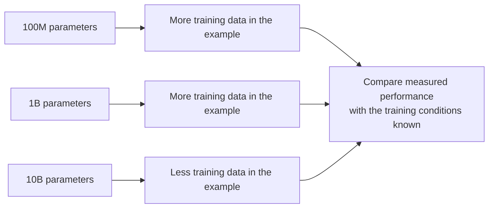
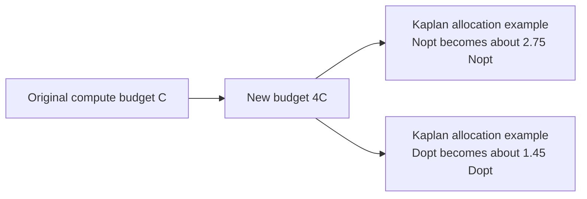

# Class 24: LLM Scaling Laws - Model Size, Data and Compute
### Production AI / LLM Engineering | Krish Naik Academy

**Mentor:** Sourangshu Pal (Paul)  
**Duration:** 1 hour 34 minutes 22 seconds | **Session:** Class 24 - 18 October 2026  
**Recording:** [18 October class](https://learn.krishnaikacademy.com/web/courses/6a16f8935e281281cd6b1128?chapter=6ad520e7b5ec8915a3134be5)

---

## Quick Updates

This was a shorter introduction to **training scaling laws**, centered on the relationship between model parameters, training tokens and compute. Paul introduced the Kaplan and Chinchilla papers, worked through simple numerical examples, and read selected model-configuration and evaluation tables. The complete papers and their remaining equations were deferred until closer to the fine-tuning module.

The announced course sequence was to move into LangChain and RAG with Divesh during Paul's absence, then return to the fine-tuning material. The closing discussion referred to the Diwali break, but the transcript did not establish a reliable complete holiday calendar. Use the course announcements for the final schedule.

A student also reported missing diagrams from earlier attention discussions. Paul requested a screenshot identifying the particular diagram before he could locate and upload it. No replacement resource was supplied during this recording.

The accompanying seven-page handwritten PDF, **Note.pdf** on the dashboard, contains the examples translated below into formulas, tables and diagrams. This session did not demonstrate a notebook or executable training implementation.

---

## Why Parameter Count Alone Cannot Rank Models

Paul began with three hypothetical language models: **100 million, 1 billion and 10 billion parameters**. Asked which would perform best, the tempting answer was the largest. He then changed the scenario: the 10B model had received less training data, while the smaller models had received more.

The point was to expose missing information. A parameter count describes one aspect of a model's capacity; it does not tell us how well that capacity was trained. A smaller, sufficiently trained model can outperform a larger model that received an unsuitable allocation of data and compute. The scenario does not prove that either smaller model must win: the dataset, training recipe and evaluation still have to be specified.

The first PDF page captures that comparison:

A related question was whether increasing parameters by **100 times** gives **100 times better performance**. There is no such linear guarantee. Even the meaning of “performance” must be pinned down: a decrease in language-model loss, an increase in benchmark accuracy, and an improvement on a particular business task are different measurements.

This is the motivation for scaling laws. Instead of choosing model size from an isolated label, estimate how model size, data and compute interact under a defined training objective. The relationships studied here are empirical fits to experiments, rather than proofs that every future architecture and dataset must behave identically.

---

## The Three Scaling Dimensions

The session repeatedly returned to three quantities:

| Symbol | Quantity | What to record |
|---|---|---|
| \(N\) | Model size | Parameter count, with the paper's counting convention stated |
| \(D\) | Training data | Token count and how it is measured |
| \(C\) | Training compute | Total floating-point operations available or consumed |

A scaling experiment changes these quantities in a controlled way, measures loss, and fits a relationship. If one resource becomes a bottleneck, expanding another may produce less benefit than expected. More parameters do not supply missing training examples, and a larger dataset is not useful to a run unless the compute budget allows the model to process it.

### Model size and the non-embedding convention

In the Kaplan discussion, \(N\) specifically refers to **non-embedding parameters**. This convention excludes vocabulary and positional embedding matrices from that paper's model-size variable. Embeddings are still real model components with parameters, storage and computational consequences. “Non-embedding” does not mean embeddings are outside the neural network or have no effect on its actual footprint.

Keep the paper's definition separate from the parameter count on a model card. A model advertised as “1B parameters” may use a different accounting convention. Likewise, the total parameter count and the number currently being optimized during fine-tuning are different quantities. Freezing a weight stops its training update; it does not remove the weight from the model. The counting convention is explicit in [Kaplan et al., Section 1.3 and Section 2.1](https://arxiv.org/pdf/2001.08361).

Paul used normalization layers to revisit trainable and non-trainable state. The useful distinction is:

- **Trainable parameters** receive optimizer updates when enabled for training.
- **Frozen parameters** remain part of the model but are excluded from those updates in the current setup.
- **Buffers and other state** can be stored with the model without being optimizer-trained parameters.

For example, BatchNorm normally has learnable scale and bias plus running mean and variance buffers. Those running statistics change during training when tracking is enabled; they are not immutable constants. LayerNorm normally computes statistics from the current input during both training and evaluation, rather than maintaining BatchNorm-style running estimates. An ordinary linear layer's bias is also normally learnable. These distinctions prevent the introductory examples from turning into incorrect general rules. See the official [BatchNorm](https://docs.pytorch.org/docs/2.14/generated/torch.nn.BatchNorm1d.html), [LayerNorm](https://docs.pytorch.org/docs/2.14/generated/torch.nn.LayerNorm.html) and [Linear](https://docs.pytorch.org/docs/2.14/generated/torch.nn.Linear.html) references.

### Dataset size means token count, not vocabulary size

\(D\) refers to the amount of training text measured in tokens. Murtaza's closing chat question made an important distinction: **training tokens are token occurrences, not the number of unique token IDs in the vocabulary**. A tokenizer with a vocabulary of tens of thousands of entries can process a corpus containing billions of token occurrences.

Also distinguish tokens available in a corpus from tokens actually processed by a training run. Repeated passes can revisit the same corpus tokens. When using a paper's formula, keep its dataset and training-token definitions consistent instead of silently exchanging these quantities. Paul clarified that the class examples concern the training set, rather than combining training, validation and test data into the budget.

### Architecture still matters

A chat question asked whether architecture should be one of the top dimensions. Architecture helps determine \(N\): layer count, hidden width and feed-forward dimensions all affect the parameter budget. However, equal parameter counts do not make all architectures equivalent. These scaling relationships are being discussed within a particular family of language-model training experiments, not as a claim that architecture can always be reduced to one integer.

---

## Compute Is a Budget, Not Just a GPU Count

Paul emphasized that even a large organization operates under a finite budget. A cluster may contain thousands of accelerators, yet it still has a limited training duration, hardware allocation and cost. The planning question remains: **how should that available compute be divided between model size and training data?**

A GPU count is not a complete compute measure. Accelerator type, numerical precision, runtime, utilization and communication overhead affect how many useful operations a run performs. Adding accelerators can shorten a fixed run when it parallelizes well. It does not automatically improve the final model if the actual training procedure and total useful work remain the same.

This addresses Deshant's chat question: isn't compute only about making training faster? Hardware throughput and total training compute are different. Faster hardware can execute the same work sooner; a larger total budget can instead enable a different choice of model, tokens or optimization steps. Scaling laws concern that resource allocation and the loss it can achieve.

### FLOPs, FLOP/s and PF-days

The terminology is easy to mix up:

| Term | Meaning |
|---|---|
| FLOPs | A count of floating-point operations |
| FLOP/s | A rate of floating-point operations per second |
| PFLOP/s | \(10^{15}\) floating-point operations per second |
| PF-day | The work performed at 1 PFLOP/s for one day |

Therefore:

\[
1\text{ PF-day}=10^{15}\times24\times3600
=8.64\times10^{19}\text{ operations}.
\]

There are **86,400 seconds** in a day. PF-days express total work, not accelerator memory capacity. They are a unit used in the Kaplan paper, rather than a metric that is meaningful only inside that paper.

When making a cost estimate, use achievable sustained throughput instead of assuming an accelerator runs continuously at its advertised peak. Precision can change throughput and memory needs, but it does not by itself replace the fitted scaling exponents with a new universal value. The class's purpose was to establish an estimate before training, rather than launching a long run and discovering its cost afterward.

---

## Reading a Loss Scaling Curve

The outcome being modeled is **cross-entropy loss**, the familiar objective used to train next-token language models. A lower loss means the model assigns better probability to the observed continuation on the evaluated distribution. It is not an accuracy percentage, and it should not be read as a direct percentage of task success.

Paul introduced the following simplified curve:

\[
L(N)=L_\infty+A N^{-\alpha}
=L_\infty+\frac{A}{N^\alpha}.
\]

| Term | Interpretation in the teaching example |
|---|---|
| \(L(N)\) | Loss associated with model size \(N\), under the conditions being modeled |
| \(L_\infty\) | The asymptotic floor approached by this fitted curve |
| \(A\) | A coefficient setting the size of the reducible-loss term |
| \(\alpha\) | A positive scaling exponent controlling how that term decreases |

The negative exponent is the key algebraic step:

\[
N^{-\alpha}=\frac{1}{N^\alpha}.
\]

For positive \(N\) and \(\alpha\), a larger \(N\) makes the denominator larger and this contribution smaller. The curve approaches its floor rather than improving by a fixed amount every time more parameters are added.

**The floor is not an arbitrary target that a researcher chooses to make the model reach.** The class set it to 1 to make the arithmetic easy. In a fitted model, the floor is inferred or justified for the data distribution and assumptions. There is no universal rule that language-model cross-entropy must approach zero, that the floor should normally be 1, or that an observed zero loss always indicates the same problem.

For source fidelity, the whiteboard curve is a general teaching form. Kaplan's displayed parameter-only power law has a different written form, \(L(N)=(N_c/N)^{\alpha_N}\), under its stated conditions. Treat the class's \(1,10,0.5\) choices as hypothetical values, not coefficients quoted from Kaplan's experiments.

---

## Worked Example: More Parameters and Diminishing Gains

For the main exercise, Paul chose:

\[
L_\infty=1,\qquad A=10,\qquad\alpha=0.5.
\]

The formula becomes:

\[
L(N)=1+\frac{10}{\sqrt N}.
\]

The PDF's completed calculation is:

| Hypothetical model size \(N\) | \(\sqrt N\) | Reducible term \(10/\sqrt N\) | Total loss |
|---:|---:|---:|---:|
| 100 | 10 | 1.00 | 2.00 |
| 400 | 20 | 0.50 | 1.50 |
| 2,500 | 50 | 0.20 | 1.20 |
| 10,000 | 100 | 0.10 | 1.10 |

The live calculation initially used 1.25 for \(N=2,500\), then corrected it to **1.20**. The arithmetic follows directly from \(10/50=0.20\).

Compare the successive changes:

| Model-size change | Parameter multiplier | Absolute loss reduction |
|---|---:|---:|
| 100 to 400 | 4 times | \(2.00-1.50=0.50\) |
| 400 to 2,500 | 6.25 times | \(1.50-1.20=0.30\) |
| 2,500 to 10,000 | 4 times | \(1.20-1.10=0.10\) |

These are **loss differences**, not 0.5%, 0.3% or 0.1% improvements. A relative percentage reduction would require dividing by the earlier loss. The main lesson is that much larger parameter counts can buy progressively smaller absolute improvements as the curve approaches its floor.

The equal fourfold changes are especially useful to compare. Going from 100 to 400 halves the excess above the floor from 1.00 to 0.50. Going from 2,500 to 10,000 also halves that excess, from 0.20 to 0.10. The proportional change in the reducible term is the same, while the absolute gain is smaller. This is more precise than treating every row as an equal increase in model size.

---

## What the Exponent and Coefficient Change

### The exponent controls the decay

To make exponents concrete, Paul held \(N=10\) and varied \(\alpha\):

| \(N\) | \(\alpha\) | \(N^\alpha\) | \(N^{-\alpha}\) |
|---:|---:|---:|---:|
| 10 | 1 | 10 | 0.1 |
| 10 | 2 | 100 | 0.01 |
| 10 | 3 | 1,000 | 0.001 |

This table explains how a positive exponent in the denominator produces a decreasing term. It does **not** mean a researcher can simply select a larger exponent and make an actual trained model better. In an empirical law, the exponent describes the observed relationship; changing its value on paper changes the prediction, not the underlying training result.

The earlier choice of \(\alpha=0.5\) was made because it turns the denominator into a square root. It should not be confused with the later 0.73 compute-allocation exponent. Those exponents describe different relationships.

### The coefficient sets the magnitude

Next, Paul kept \(N=100\), \(\alpha=0.5\), and \(L_\infty=1\), but varied \(A\). Since \(\sqrt{100}=10\):

\[
L(N)=1+\frac A{10}.
\]

| \(A\) | Predicted loss |
|---:|---:|
| 1 | 1.1 |
| 5 | 1.5 |
| 10 | 2.0 |
| 20 | 3.0 |

At the same \(N\), increasing \(A\) increases the reducible-loss term. This is a comparison between curves. It is not an instruction to manually lower \(A\) to reduce the model's measured loss.

### Where fitted values come from

Sohil's question at the end returned to this point: given a dataset of text, how can one estimate \(A\)? The answer is to run training experiments under different configurations, measure their losses, and fit the coefficients and exponents to those observations. Reading the text alone does not reveal an exact coefficient.

The number of experiments is a design choice, not a requirement to run exactly 100 models. Nor must \(A\) be an integer, below 5, or shared across all datasets. Its numerical value also depends on how \(N\) is expressed: using raw parameters rather than billions of parameters changes the coefficient needed to represent the same curve. Keep units and fitted assumptions with the formula.

The practical exercise is to substitute numbers until the role of each term is clear. The research task is different: collect measurements and check that the proposed relationship predicts them adequately.

---

## The Chinchilla Heuristic: Training Tokens Relative to Parameters

Paul then introduced the memorable approximation:

\[
D\approx20N.
\]

Here \(N\) is the parameter count used for the estimate and \(D\) is the training-token budget. The examples on the handwritten pages are:

| Parameters \(N\) | Approximate tokens \(20N\) |
|---:|---:|
| 1 billion | 20 billion |
| 7 billion | 140 billion |
| 70 billion | 1.4 trillion |
| 1 trillion | 20 trillion |

Keep the scale consistent. **Seven billion parameters times 20 gives 140 billion tokens**, not 140 million. The 70B arithmetic is a hypothetical planning example; it does not establish the actual training dataset of a particular Llama release mentioned in conversation.

The ratio is a useful way to remember the Chinchilla discussion: budget for enough training data rather than spending everything on a larger parameter count. But **20 tokens per parameter is an approximate compute-optimal pretraining heuristic for the studied setting, not a universal minimum dataset size, a performance guarantee, or a ceiling on useful training**. It is not a rule that a pretrained 7B model requires a new 140B-token fine-tuning dataset.

Sohil explicitly asked whether 20 generalizes to every LLM. Paul clarified that the relationship is empirical and depends on the lab's data and experiments. That qualification matters more than memorizing the multiplier alone. The objective being optimized, data quality, model family and training conditions determine whether a fitted relationship transfers.

---

## Kaplan Allocation: What Changes When Compute Increases?

The next exercise concerned the **optimal allocation of a training-compute budget**. The class used the Kaplan relationships:

\[
N_{\mathrm{opt}}\propto C^{0.73},
\qquad
D_{\mathrm{opt}}\propto C^{0.27}.
\]

“Optimal” means the choice favored by the specified loss objective and resource assumptions. It does not mean the best architecture for every downstream application. Kaplan's source uses the adjusted compute quantity \(C_{\min}\) for this result; the class shortened the notation to \(C\).

A proportionality does not give an absolute parameter count without its fitted coefficient. It does let us compare a new budget with an old one under the same law:

\[
\frac{N_{\mathrm{new}}}{N_{\mathrm{old}}}
\approx
\left(\frac{C_{\mathrm{new}}}{C_{\mathrm{old}}}\right)^{0.73},
\qquad
\frac{D_{\mathrm{new}}}{D_{\mathrm{old}}}
\approx
\left(\frac{C_{\mathrm{new}}}{C_{\mathrm{old}}}\right)^{0.27}.
\]

### Four times the compute

Using the class's exponents:

\[
4^{0.73}\approx2.751,
\qquad
4^{0.27}\approx1.454.
\]

The resulting allocation is roughly **2.75 times the parameters and 1.45 times the training tokens**. The whiteboard rounded these numbers to approximately 2.7-2.77 and 1.4; the values above retain the arithmetic for the stated exponents.

The PDF's final comparison table can be represented as:

A multiplier of 1.45 means the new amount is about 145% of the old amount, or about **45% additional data**. It does not mean a 145% increase on top of the original amount.

### Eight times the compute

Similarly:

\[
8^{0.73}\approx4.563,
\qquad
8^{0.27}\approx1.753.
\]

| Compute multiplier | Parameter multiplier under \(C^{0.73}\) | Token multiplier under \(C^{0.27}\) |
|---:|---:|---:|
| 4 | 2.751 | 1.454 |
| 8 | 4.563 | 1.753 |

The class's 4.56 and 1.7 approximations express the same directional idea. More compute permits both resources to grow, but these exponents allocate more of that growth toward parameters.

A fourfold compute budget is not automatically the same thing as four times as many GPUs. That equivalence would require comparable devices, runtime and effective utilization. The equations describe total training work, while a cluster configuration determines how efficiently and quickly that work can be delivered.

---

## Keep the Kaplan and Chinchilla Results Distinct

The lecture moved between the two papers to build intuition. When reviewing the equations together, preserve their different conclusions:

| Result discussed | Parameter allocation | Token allocation | Interpretation |
|---|---|---|---|
| Kaplan example | \(N_{\mathrm{opt}}\propto C^{0.73}\) | \(D_{\mathrm{opt}}\propto C^{0.27}\) | Parameter count grows faster than token count |
| Chinchilla's approximate conclusion | Near \(C^{0.5}\) | Near \(C^{0.5}\) | Parameters and tokens grow in roughly equal proportions |

Chinchilla's Table 2 contrasts its fitted approaches with Kaplan's 0.73/0.27 values. It does not present those earlier values as its own preferred allocation. Thus the class's \(D\approx20N\) mnemonic and the 0.73/0.27 example should not be combined as simultaneous exact constraints. See [Hoffmann et al., Table 2](https://arxiv.org/pdf/2203.15556).

Paul's broader point was that model size, data and compute must be considered together. Read the warning about growing parameters faster than data as a resource-balance warning, rather than a rule that any such growth inevitably makes absolute loss increase. A new model can still improve while using compute less effectively than another feasible allocation. Data limitation can also introduce diminishing returns and generalization problems; it should not automatically be labeled “underfitting.”

The fitted exponents are tied to a regime and experimental setup. One part of the discussion compared 0.73 with 0.74, but these can belong to different relationships in the papers. Check what is on each axis before treating nearby numbers as interchangeable rounding.

The class only previewed notation such as \(L(N,D)\), \(N_{\mathrm{opt}}\), \(D_{\mathrm{opt}}\) and minimizing a loss. It did not derive the complete constrained optimization or all of either paper's equations.

---

## Reading the Gopher and Chinchilla Comparison

The final paper walkthrough returned to the opening question: can a smaller model perform better? Paul compared **Gopher, at 280B parameters, with Chinchilla, at 70B**, and examined the architecture and evaluation tables.

The comparison's central result was a smaller model trained with a different allocation of data at a comparable training-compute budget. Chinchilla was trained on **1.4 trillion tokens**. Parameter count alone would not have predicted the observed ranking.

The architecture table shown in the paper provides a concrete bridge to the earlier Transformer lessons:

| Configuration | Gopher | Chinchilla |
|---|---:|---:|
| Transformer layers | 80 | 80 |
| Attention heads | 128 | 64 |
| Key/value head size | 128 | 128 |
| Model width \(d_{\mathrm{model}}\) | 16,384 | 8,192 |
| Maximum learning rate | \(4\times10^{-5}\) | \(1\times10^{-4}\) |
| Batch size in tokens | 3M to 6M | 1.5M to 3M |

“80 layers” here means Transformer blocks, not a sum in which each attention, normalization and feed-forward subcomponent is counted as a separate one of the 80. The table also illustrates why size is not determined by depth alone: the two models have the same block count but different widths and head counts.

Batch size is expressed in **tokens**, not three million independent documents or requests. Paul used that scale to emphasize the infrastructure involved. The paper reports TPU-based training, so its compute results should not be relabeled as measurements from a particular GPU cluster.

The evaluation discussion covered language modeling, reading comprehension, question answering, common sense, MMLU and BIG-bench. The relevant habit is to read the metric and task setup alongside the score. A lower language-model loss and a higher multiple-choice accuracy are improvements in different metrics.

The displayed MMLU table reports **60.0% for Gopher and 67.6% for Chinchilla in the five-shot setting**, a difference of **7.6 percentage points**. That does not mean 7.6% relative improvement, nor does an average result mean every individual subject improved. The paper also cautions about possible train/test leakage in its language-model evaluations. These details support the broad comparison without turning it into a claim that the smaller model won every task without exception. See [Chinchilla, Section 4 and Tables 4-6](https://arxiv.org/pdf/2203.15556).

MMLU is an example of a broad benchmark, rather than sufficient evidence that a model is suitable for every domain. Paul's recommendation was to inspect the experimental configurations and results, not merely read the abstract or memorize a model's parameter label.

---

## Closing Clarification: Who Chooses Which Weights to Train?

Aiswarya asked whether the model provider decides which weights remain frozen, or whether the person fine-tuning chooses. Her follow-up concerned the risk of changing too much of a pretrained model's existing capability.

Where the training interface permits it, the practitioner chooses the adaptation strategy and which parameters to optimize. Three possibilities should be kept separate:

| Approach | What is updated? |
|---|---|
| Full fine-tuning | All selected base-model parameters, potentially the entire model |
| Partial fine-tuning | A chosen subset of base-model layers or parameters |
| Parameter-efficient fine-tuning | A smaller set of adaptation parameters, often while the base weights remain frozen |

Paul used unfreezing the last two layers, then four layers, as a transfer-learning example. Training more parameters generally increases optimizer-state and gradient work, although actual runtime also depends on the implementation. It does not imply a universal requirement that 60-70% remain frozen, or that updating more than the last 20-30% is prohibited. Full fine-tuning is an established alternative; the official [PEFT overview and quicktour](https://huggingface.co/docs/peft/quicktour) explicitly distinguish it from parameter-efficient methods.

The concern about losing useful pretrained behavior is valid. Evaluate both the target task and the capabilities that must be retained. The class did not conduct a forgetting experiment or establish a safe percentage of weights to change.

Finally, being able to modify weights requires suitable access, tooling and applicable permissions. Calling a model “open source” is not the technical condition that determines whether its gradients can be enabled. Open weights and an open-source AI release are not interchangeable labels; the [Open Source Initiative's definition](https://opensource.org/ai/open-source-ai-definition) includes requirements beyond access to parameter files.

This was a conceptual Q&A clarification. The class did not implement layer freezing, LoRA or a fine-tuning loop.

---

## What's Next

Paul deferred the full scaling-paper walkthrough, the remaining loss and optimization equations, and their deeper training applications until before the fine-tuning module. Students were asked to browse the papers' summaries, graphs and tables in preparation, even if all the derivations were not yet clear.

The next announced teaching block was LangChain and RAG with Divesh. OCR and vision-language material were left for the multimodal stage. Mixture of experts and quantization were not started as substitutes for the planned sequence. A brief prediction about future reinforcement-learning progress was an outlook comment, not a study of RL scaling laws in this session.

---

## Live Q&A Highlights

| Question | Answer |
|---|---|
| Which is best: the 100M, 1B or 10B model? | Parameter count alone is insufficient. Compare the data, training compute and actual evaluation rather than inferring a ranking from size. |
| Does 100 times more parameters give 100 times better performance? | No linear improvement follows from that change. The metric, other resources and empirical relationship matter. |
| Which parameters does \(N\) count? | In the Kaplan discussion it counts non-embedding parameters. This is a paper-specific convention; embeddings remain real parameters and consume resources. |
| Are frozen weights absent from model size? | No. Total model parameters and currently trainable parameters are different counts. Freezing changes the optimization setup. |
| What is the normalization example of non-trainable state? | BatchNorm can maintain running mean and variance buffers. They are updated statistics rather than optimizer-trained weights; LayerNorm normally uses current-input statistics instead. |
| Deshant: doesn't compute only make training faster? | Faster hardware can shorten the same work. A larger total training budget can instead support a different model/data allocation and a different achievable loss. |
| Deshant: where does architecture fit among the dimensions? | Architecture determines much of the parameter count, but equal counts do not make every architecture equivalent. The laws apply within their experimental setting. |
| What does \(L(N)\) represent? | The loss associated with a model size under the modeled conditions. Here the training objective is cross-entropy, not an accuracy percentage. |
| Is \(L_\infty=1\) a universal goal? | No. One was chosen for the arithmetic example; an actual asymptotic floor depends on the fitted setting. |
| Is the loss for 2,500 parameters 1.25? | The live calculation was corrected to 1.20: \(1+10/50=1.20\). |
| Are the 0.50, 0.30 and 0.10 changes percentages? | They are absolute differences in the toy loss values. Relative percentages need a denominator. |
| Can a researcher choose a higher \(\alpha\) or lower \(A\) to improve the model? | Changing a formula changes its prediction. Real fitted values must be supported by measured training results. |
| Sohil Sharma: how is \(A\) estimated from a text dataset? | Train configurations, measure their losses and fit the relationship. It cannot be read directly from words in the dataset, and it need not be an integer or below 5. |
| Sohil Sharma: where does the multiplier 20 come from? | It summarizes empirical compute-optimal training analysis. It is not an axiom or a universal minimum token count. |
| Sohil Sharma's follow-up: does the same ratio apply to any LLM? | No. Data, model family, training setup and the optimization objective affect the applicable relationship. |
| Murtaza: are training tokens unique tokens? | They are total token occurrences, not vocabulary entries. The class examples concern the training set; check whether a source counts corpus size or processed tokens. |
| Why not always use \(D=20N\) together with the 0.73/0.27 exponents? | They summarize different empirical allocation results. Chinchilla contrasts its near-equal scaling conclusion with Kaplan's earlier allocation. |
| Does FP16 affect the analysis? | Precision can affect memory, throughput and numerical behavior. It does not directly turn a fitted exponent into a precision-independent universal rule. |
| What does a fourfold compute budget imply in the Kaplan exercise? | About 2.75 times the parameters and 1.45 times the tokens for the stated exponents, rather than a fourfold increase in each. |
| Aiswarya: who chooses what is frozen during fine-tuning? | The practitioner chooses the trainable subset or adaptation method where the training interface allows it. A managed provider may constrain those choices. |
| Aiswarya's follow-up: can changing more weights damage existing capabilities? | It can change retained behavior, so evaluate it. There is no universal rule limiting all fine-tuning to the last 20-30% of weights. |
| Does weight modification require an “open-source” model? | It requires suitable access and permissions. Open weights, a trainable service and an open-source AI release are distinct concepts. |
| What about OCR, vision-language models, MoE and quantization? | These were deferred to their relevant modules. The class did not establish that text-model exponents transfer unchanged to all multimodal settings. |

Mosine/Mohsin was invited to speak, but no substantive question is recorded. A briefly called name rendered as Rashmi likewise has no separate substantive exchange. These invitations do not supply additional technical answers.

---

## Key Pointers to Remember

- A parameter count is a resource description, not a model-quality ranking.
- Scaling analysis connects model parameters, training tokens and total training compute.
- Keep non-embedding parameter counts, total parameters and trainable parameters distinct.
- Embedding matrices remain part of the model even when a paper excludes them from \(N\).
- FLOP/s is a rate; PF-days measure total work. One PF-day is \(8.64\times10^{19}\) operations.
- The class's \(1+10/\sqrt N\) curve is a hypothetical arithmetic example.
- Its losses are 2.00, 1.50, 1.20 and 1.10; its successive reductions are absolute loss units.
- Fitted coefficients and exponents describe measured behavior. They are not free controls for improving a trained model.
- \(D\approx20N\) is an approximate pretraining compute-allocation heuristic, not a universal minimum or a fine-tuning dataset rule.
- Kaplan's 0.73/0.27 allocation and Chinchilla's near-equal allocation are different results.
- A multiplier such as 1.45 means 45% more than the original amount.
- Read benchmark scores with their task, metric, prompting setup and limitations.
- Freezing is a training choice; full, partial and parameter-efficient fine-tuning are all possible strategies.

---

## Action Items After Class 24

- [ ] Recalculate \(1+10/\sqrt N\) for all four model sizes and verify the corrected 1.20 result.
- [ ] Reproduce the fixed-\(N\) table for \(A=1,5,10,20\), explaining what is held constant.
- [ ] Calculate fourfold and eightfold compute changes using the 0.73 and 0.27 exponents.
- [ ] Explain in your own words why the \(20N\) mnemonic and Kaplan allocation are not one simultaneous universal rule.
- [ ] Browse the Kaplan paper's summary and notation, paying attention to what \(N\), \(D\) and compute mean.
- [ ] Read Chinchilla's allocation comparison, model-configuration table and benchmark results; distinguish model size from quality.
- [ ] For a hypothetical training plan, record the parameter convention, token budget, compute units and evaluation objective before estimating resources.
- [ ] Review trainable parameters, frozen weights and normalization buffers before the fine-tuning module.

---

## Sources

The primary source is the [full Class 24 recording and transcript](https://learn.krishnaikacademy.com/web/courses/6a16f8935e281281cd6b1128?chapter=6ad520e7b5ec8915a3134be5), original transcript **GMT20261018-143238_Recording.cutfile.20261018194139540.transcript.vtt**. The complete accompanying seven-page **Note.pdf** was also inspected.

The original research references discussed in class are [Scaling Laws for Neural Language Models - Kaplan et al.](https://arxiv.org/abs/2001.08361) and [Training Compute-Optimal Large Language Models - Hoffmann et al.](https://arxiv.org/abs/2203.15556). Selected equations, notation and comparison tables were checked against those papers. Official framework references linked in the relevant sections clarify normalization state and fine-tuning terminology.

*Notes compiled from the full Class 24 transcript and accompanying handwritten notes - “LLM Scaling Laws - Model Size, Data and Compute,” Production AI / LLM Engineering, Krish Naik Academy. No executable code was shown in this session.*
