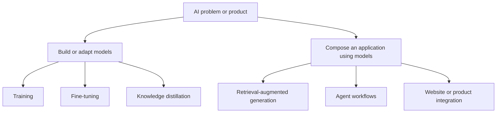
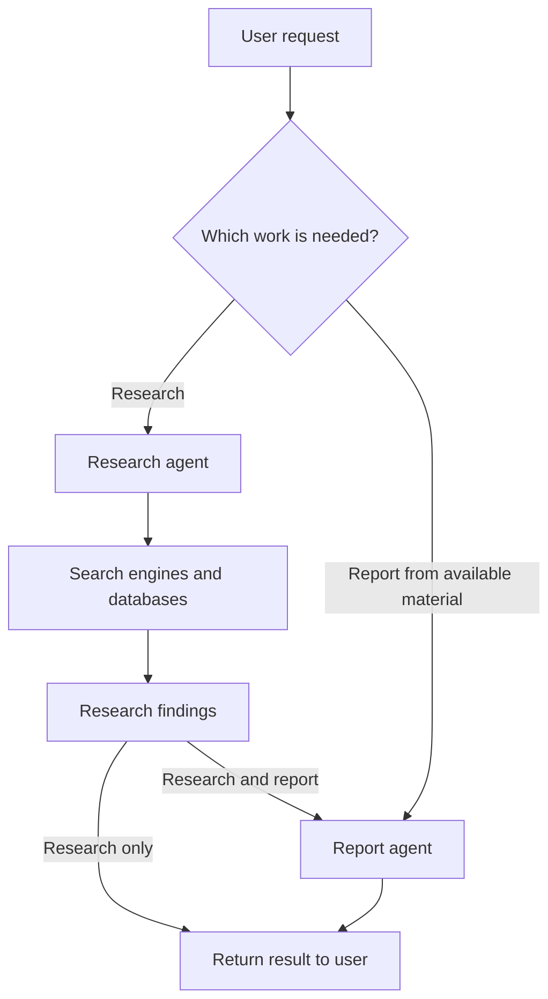
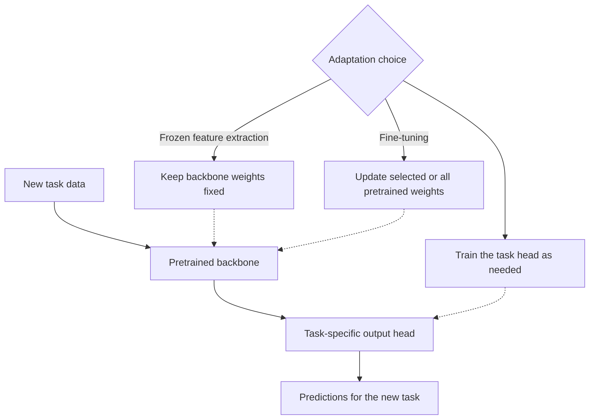
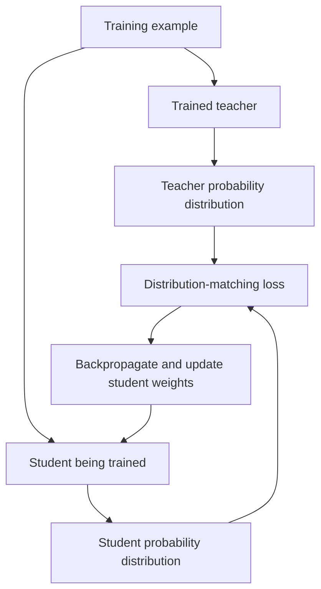
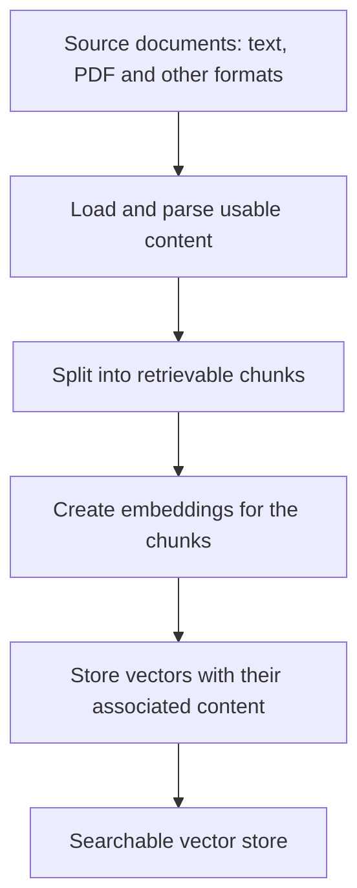
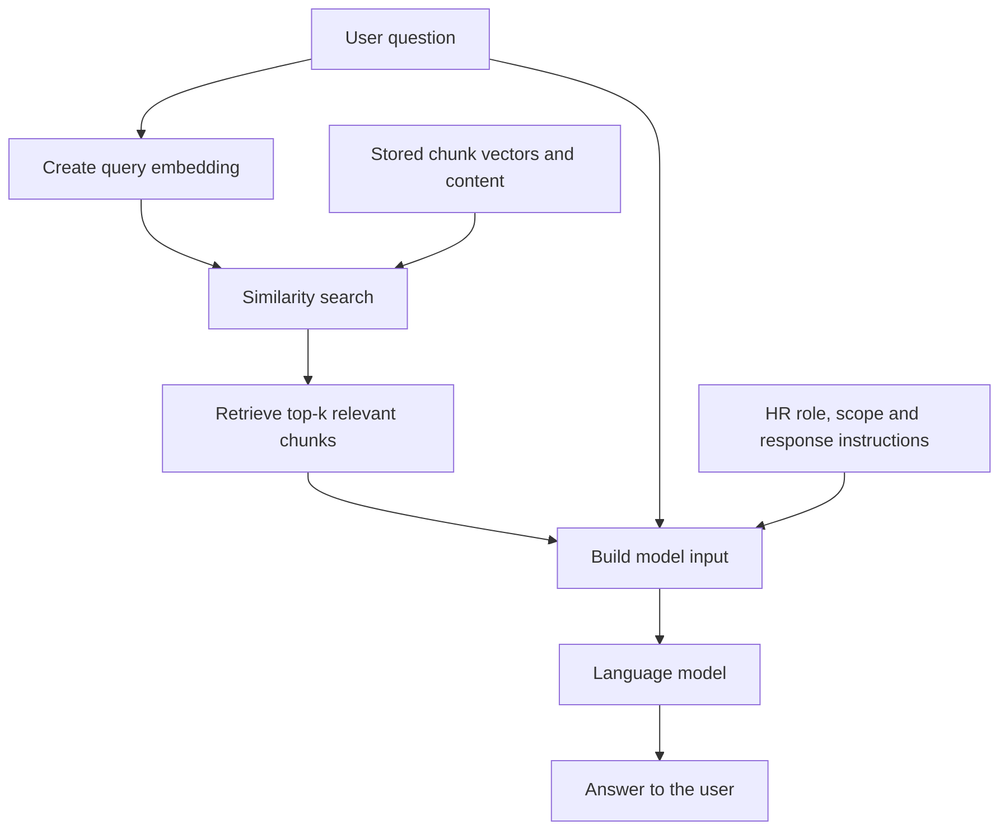

# Class 25: AI Application Engineering and RAG Foundations
### Production AI / LLM Engineering | Krish Naik Academy

**Mentor:** Divesh Jadhwani  
**Duration:** 2 hours 48 minutes 40 seconds | **Session:** 24 October 2026

---

## Quick Updates

Divesh introduced the application-building portion of the course while Sourangshu Pal was away. The session connected the earlier model architecture lessons to products that use models, then developed the conceptual pipeline for an HR-policy assistant. Although a LangChain practical was initially planned, the class finished with demonstrations, diagrams and questions; the notebook implementation moved to the following session.

The mentor announced a Diwali break on **7 and 8 November**, with classes planned for **31 October and 1 November** and Pal's return planned for **14 and 15 November**. These are the arrangements announced in this recording.

The dashboard supplies the [HR Policy Assistant demonstration](https://guardthisrag.streamlit.app/) and [Groq](https://groq.com/). The instructor's [application repository](https://github.com/d-hackmt/adv-batch-langchain), supplied with the following class, is a companion for the practical. Its current notebook must not be mistaken for code executed during this session.

---

## From Understanding Models to Building Applications

Divesh opened with a useful change in perspective: earlier lessons examined what happens inside models; the next set asks how a software system can put those models to work. Knowing tokenization, attention and training helps explain the capabilities and limits of the component. Application engineering connects that component to a user interface, business data, tools and a workflow.

He contrasted **making or adapting models** with **using models**. In the first group, a team might train a model, fine-tune pretrained weights or distill a model for deployment. In the second, a team might connect an existing model to a website, build a retrieval workflow or coordinate several agents. These are overlapping areas of engineering rather than an exhaustive classification of AI. A retrieval application can use a fine-tuned model, and a product team can own both its model adaptation and its orchestration.

The PDF's branching sketch captures this teaching contrast:

A practical implication is that using an LLM is not the same as training it. Calling a model from a chatbot, supplying documents in a prompt and routing requests between tools normally leave the base model's weights unchanged. Conversely, an application that uses an LLM is not automatically an autonomous agent: some workflows have a fixed sequence of software steps.

Divesh's repeated emphasis was to identify the problem and its components. A product still needs a sensible interface, reliable access to its data and a clear response path. The model provides a capability within that system; it does not remove the need to design the surrounding software.

---

## Product Demonstrations: Natural Language Meets Existing Data

### Flight search and an interactive interface

The IndiGo example began with an informal request for a morning flight from Pune to Bangalore around Diwali. Instead of filling every field in a traditional form, the user supplied an intention in ordinary language. The assistant requested missing details, clarified that the trip was one way and produced flight-related interface elements.

This demonstrated two distinct responsibilities: interpreting what the user wants, and turning that intention into an interaction with a product. A phrase such as “around Diwali” still needs to become usable dates; “I am travelling alone” still has to be reconciled with whatever fields the booking flow requires. The assistant's additional question about children illustrated that a conversational interface may ask redundant questions. The class did not establish why that particular application asked it.

Divesh used **AG2UI** as classroom shorthand for an agent producing an interactive user interface, including cards and buttons. The important concept was the transition from a text-only answer to an actionable interface. No formal protocol specification or frontend-generation implementation was inspected, so the label should be understood in that classroom sense.

### Product search and location-aware assistance

Amazon Rufus was asked for baggy jeans under ₹2,000, then for men's options ordered from cheaper to more expensive. Google Maps examples included a nearby petrol pump and a two-day Mumbai itinerary. Travel-planning examples extended the same idea to a Goa trip.

Across these examples, the common pattern was:

1. Understand a request and obtain necessary clarifications.
2. Find information relevant to that request.
3. Present an answer, recommendation or interface that the user can use.

Divesh explained these interfaces in terms of access to product, flight or location data. That is a useful architectural interpretation of the demonstrations, but the class did not inspect their private databases, API calls or source code. It therefore does not prove that any named product uses a specific model, agent framework, database or HTML-generation method. No booking or purchase was completed as part of the lesson.

The examples also explain why a business application can differ from a general chat assistant. The application can place its own data and workflow close to the user: products in a shopping context, policies in an employee context, or a map in a travel context. The value comes from the complete interaction, not merely from adding a chat box.

---

## The LangChain Ecosystem: Components, Routing and Observability

Divesh introduced LangChain, LangGraph and LangSmith as related tools with different responsibilities. Other framework names, including Pydantic AI, Google ADK and Microsoft AutoGen, appeared as alternatives; this was not a comparative implementation lesson.

| Tool | Classroom emphasis | Useful distinction |
|---|---|---|
| LangChain | Connecting models and application components; a simple chain of steps | A convenient starting point for models, tools and agent abstractions |
| LangGraph | Routing and coordinating more complex workflows | Explicit state and control over execution paths |
| LangSmith | Seeing what happened during a model or workflow run | Tracing, debugging, evaluation and monitoring |

The simple chain drawing was **A → B → C → D**: each step passes work to the next. The graph example used two conceptual agents in a pharmaceutical research workflow. A research agent could consult search engines or databases, while a report agent could turn material into a report. A request might need research alone, reporting alone, or research followed by reporting.

The following translates the PDF's routing structure. The pharmaceutical setting is an orchestration example, not a validated drug-discovery procedure or medical recommendation.

The chain-versus-graph contrast helps introduce control flow, but it is not a rigid boundary between the libraries. Current documentation describes LangChain's agent abstractions and LangGraph's lower-level orchestration, including combinations of deterministic and model-driven steps. LangGraph can be used independently of LangChain. These frameworks compose applications; they do not inherently train new model weights. [LangChain overview](https://docs.langchain.com/oss/python/langchain/overview), [LangGraph overview](https://docs.langchain.com/oss/python/langgraph/overview).

For observability, Divesh asked students to think beyond the final answer. Which prompt went to the model? Which agent or tool ran? How many tokens were used, how long did a step take, and where did cost accumulate? Those are the questions a trace can help answer. LangSmith supports tracing across frameworks as well as monitoring and evaluation; knowing the execution path makes a multi-step failure easier to investigate. [LangSmith Observability](https://docs.langchain.com/langsmith/observability).

No graph, tracing integration or LangChain chain was implemented live in this session. The point was to recognize where each responsibility belongs before writing the application.

---

## Learning From Documentation and Directing Coding Assistants

The mentor demonstrated the question-answering feature in LangChain's documentation. He asked for a short definition of LangChain and for guidance on whether a RAG system should use LangChain or LangGraph. The visible interaction involved searching documentation and returning an explanation with supporting material.

This was both a product example and a learning method. Documentation can answer a current API question more directly than an old tutorial, particularly when a library changes. A coding assistant can help navigate it, but an engineer still needs enough understanding to judge the answer, inspect the generated code and connect components correctly.

Divesh connected this to system design. Before asking an assistant to implement a workflow, be able to explain what information moves between its stages, what each stage does and where state is stored. Terms such as middleware, streaming and memory are not interchangeable features to request blindly; they change how a system behaves. A diagram or an API reference can make the implementation request more precise.

A learning-product demonstration, referred to as Vidya AI, combined documentation, videos, an AI mentor and a highlighting interface. AI labs were described as an upcoming feature. The product was presented as a tailored learning experience rather than proof that a general assistant cannot provide useful explanations.

Questions about bring-your-own-key access and local models were specific to that product demonstration. Divesh said its current integration used a Gemini key. That does not establish that LangChain or RAG cannot use local models. Similarly, a bring-your-own-key interface does not by itself establish how a service stores, transmits or deletes keys. No security or storage implementation was audited during the class. Free provider access, where available, remains subject to the provider's current quotas and terms.

The study advice was to combine documentation reading, conceptual understanding and code inspection. Generating code can save effort, but accepting code that one cannot explain makes later debugging and system design harder.

---

## Transfer Learning and Fine-Tuning: Reusing What Was Learned

### A pretrained network is a starting point

Divesh used an image-classification example to explain why a team might reuse an existing model. A pretrained network has already learned useful representations from a prior task. A new task, such as distinguishing cats from dogs, may benefit from that starting point instead of learning every feature from randomly initialized weights.

The classroom examples mentioned ResNet and Inception and contrasted a broad classifier with a two-class task. The class-count change belongs at the **output classification head**. It is not a change from “100 input classes” to “two input classes,” and it does not by itself change image channels or the dimensions of the input data.

Two common reuse strategies make the distinction concrete:

- **Frozen feature extraction:** keep the pretrained backbone fixed and train an appropriate task head on its representations.
- **Fine-tuning:** update some or all pretrained parameters for the new task, possibly together with a new head.

Fine-tuning is itself a transfer-learning method. Freezing a backbone means its parameters are not updated; it does not mean that the complete application has no training step. Nor does freezing automatically turn the backbone into a smaller network. These distinctions match the official computer-vision transfer-learning tutorial. [PyTorch transfer-learning tutorial](https://docs.pytorch.org/tutorials/beginner/transfer_learning_tutorial.html).

The PDF showed a network with early layers retained and later layers adapted. Its structure can be read as follows:

Divesh used lower training effort and better reuse as the motivation. The illustrative comparison of a long pretraining run with a few adaptation epochs was not an experiment performed in class. The spoken epoch counts and accuracy percentages are not guarantees for an arbitrary dataset. The task, data distribution, initialization, trainable parameters and evaluation procedure determine whether transfer helps.

### Specializing an LLM

The same broad idea was applied to a general language model and a medical-domain task. A team may adapt a pretrained model to particular instructions, response formats or task examples. Divesh mentioned medical model families to make specialization tangible; the class did not inspect those models' training recipes, validate clinical performance or implement a medical fine-tune.

He illustrated adaptation by unfreezing a few later layers. That is one possible arrangement, not the definition of all LLM fine-tuning. LoRA was acknowledged in response to a student, but its mechanics and parameterization were not taught here.

A later question from sridhar k clarified the training data. Instruction-following examples and question-answer pairs are possible formats; the appropriate choice depends on the intended task. Merely owning a directory of documents does not specify a complete supervised training recipe. The class did not construct such a dataset or choose a fine-tuning loss, optimizer or evaluation set.

---

## Knowledge Distillation: Supervision From a Teacher

Divesh first previewed distillation briefly, then returned to it in the final Q&A. The deployment example was a camera inspecting cans on an industrial line. A larger classifier might be inconvenient to deploy on a resource-constrained device; a smaller student is an alternative, and a teacher can provide training supervision for it.

The example's model sizes and edge-device memory limits were hypothetical. The useful reasoning is to compare a model's resource requirements with the device budget. It does not follow that every smaller model must be less accurate than every larger model, or that distillation will preserve a teacher's accuracy on every task.

The class contrasted **hard labels**, such as a target assigning a class a value of one, with **soft targets**, such as a teacher assigning probabilities of 0.89 and 0.11. A probability distribution can convey relationships that a single winning label does not show. The student produces its own predictions, compares them with the supervision and updates its weights.

Sridhar's follow-up asked how the student improves when its prediction disagrees with the teacher. Divesh named **KL divergence**, also called relative entropy, as a way to compare distributions. The caption's “scale divergence” refers to this term. The resulting loss supplies a training signal; backpropagation updates the student. This is a conceptual training loop, not a derivation or a completed distillation implementation.

Several distinctions keep the explanation precise. Both teacher and student can produce probability distributions. The teacher supplies training targets or representations, rather than serving as the held-out validation set. A typical offline setup keeps the teacher fixed while training the student, and may combine a teacher-target loss with a true-label loss. The official tutorial demonstrates this arrangement. [PyTorch knowledge-distillation tutorial](https://docs.pytorch.org/tutorials/beginner/knowledge_distillation_tutorial.html).

A larger teacher and a smaller student are the compression case discussed here, not a requirement that defines every distillation method. Likewise, reusing the teacher's original training dataset is not a universal requirement. The original distillation work discusses transferring behavior through soft targets on a transfer set. [Hinton, Vinyals and Dean, *Distilling the Knowledge in a Neural Network*](https://arxiv.org/abs/1503.02531).

Finally, a predicted probability, confidence, accuracy and overfitting are different concepts. A correct prediction or a reported 100% score does not alone establish overfitting. That question requires an appropriate evaluation of generalization. No such experiment was conducted in the class.

---

## Why Retrieval Is Useful Alongside Model Adaptation

After the break, Divesh moved from changing a model to giving an application access to information. The motivating example was an organization with its own policies or domain documents. Training a new foundation model from scratch is a different project from making those documents available to an existing model.

Fine-tuning can change task behavior, style, format or domain performance, but it involves a training process and suitable data. Subject-matter expertise may be needed to prepare and evaluate that data. If the source information changes, a previously trained model does not automatically incorporate that change. A training cutoff also does not mean that the model reliably knows every fact published before that date.

**Retrieval-augmented generation (RAG)** addresses a different part of the problem: find relevant external material when a question arrives, supply that material as context and ask the model to generate an answer. The application's knowledge source can therefore change without updating the base model's weights for every document edit.

| Question | Fine-tuning | RAG |
|---|---|---|
| Where is the intervention? | In a training process that changes model parameters or adapters | In the application's retrieval and context-building workflow |
| What did the class emphasize? | Specialization in a task or response behavior | Access to relevant organizational information |
| How can new documents become available? | Through a suitable adaptation process, if that is the chosen route | Through updated source data and retrieval indexes |
| What remains necessary? | Training-data quality and task evaluation | Parsing, retrieval quality, freshness and answer evaluation |

Divesh emphasized retraining cost and stale knowledge as reasons to consider retrieval. The comparison is a design starting point, not an absolute rule that RAG is always cheaper or fine-tuning is always inappropriate for company data. Retrieval, embedding, storage, maintenance and repeated inference all have costs. The choice depends on workload and quality requirements.

The two approaches can also be combined. Nitish asked whether company knowledge should be fine-tuned once or whether adaptation should focus on the task's foundations. The mentor explicitly deferred the fine-tuning-plus-RAG comparison to the next class. No hybrid recipe was implemented here.

RAG also predates the recent application boom: the named RAG research paper was first submitted in **2020**. Its experiments included open-domain question answering, so retrieval augmentation is not restricted to private employee applications. Web search can similarly provide external material to a generation workflow; a product label alone does not determine whether retrieval augmentation is involved. [Lewis et al., *Retrieval-Augmented Generation for Knowledge-Intensive NLP Tasks*](https://arxiv.org/abs/2005.11401).

---

## The HR-Policy Assistant: What the Demonstration Showed

The business story was deliberately ordinary. An HR team repeatedly answers questions even though the relevant information already exists in policy documents. The proposed assistant lets employees ask in natural language and receive an answer based on those documents. The company and staffing details were an illustrative problem statement, not an account of Amazon's actual HR operations.

The demonstration used an **Acme Corp** policy collection with topics such as annual leave, code of conduct and performance review. Three interactions made the intended behavior visible:

| Query | Observed classroom behavior | Lesson |
|---|---|---|
| “I want to resign. What is the process?” | The response said the supplied policy excerpts did not contain a resignation process | Missing evidence should be acknowledged rather than filled with invented policy |
| “Tell me how my performance will be judged” | The assistant described the rating scale and review process, with relevant performance material shown | A question can be connected to the policy passages supporting its answer |
| “How many vacation days do I get per year?” | The response used the annual-leave material and service-length distinctions | The answer depends on the selected corpus, not on a generic model's guess about company practice |

Divesh also tried an off-topic coffee question to illustrate an HR assistant's scope. He described internal instructions to be polite, use the available information and decline unrelated requests. The demonstration did not establish that such instructions are an infallible security boundary or that the system will always retrieve the right policy.

The companion [HR Policy Assistant](https://guardthisrag.streamlit.app/) currently identifies itself as a NeMo Guardrails and FAISS RAG application. A read-only inspection during preparation showed a bring-your-own Groq-key field and a pipeline labelled PII regex, intent guard, FAISS top-three retrieval, answer generation and output regex. That current interface corroborates the demonstration's identity; it is not proof that every component or model selection was identical in the recording. No key was entered and no runtime query was submitted during note preparation.

Security and guardrails were mentioned as later discussion. A labelled guard or regex check can reduce particular risks, but the UI's claims do not establish that all sensitive-data leakage is prevented. The class did not audit its implementation or test adversarial behavior.

The provider name in this demonstration is **Groq**, despite captions that sometimes render it as “Grok.” Divesh advised choosing the available OpenAI-family model options because the demo's older Llama options were no longer working. Treat that as provider- and application-specific migration advice: support and deprecation apply to particular model IDs and access tiers, not to a universal disappearance of Llama models. Check the provider's [supported models](https://console.groq.com/docs/models) and [deprecation history](https://console.groq.com/docs/deprecations). Free access is also rate-limited rather than unlimited. [Groq rate limits](https://console.groq.com/docs/rate-limits).

---

## RAG Phase One: Prepare Searchable Information

Divesh divided the workflow into a **data-ingestion phase** and a **data-retrieval phase**. Ingestion prepares the corpus; retrieval serves the user's question. The developer-side versus user-side distinction describes their roles in this application, rather than a universal access-control rule about who may upload documents.

The PDF's ingestion path is the backbone of the explanation:

### Load and parse

The first step is to obtain content that the downstream application can use. A text file, a PDF, a table, an image and an audio recording do not have identical extraction needs. The class placed that responsibility in loading and parsing: write or select an appropriate extraction process before assuming the content can enter the text pipeline.

For the HR example, the source was policy text. Divesh did not implement a PDF-table parser, image extraction, speech transcription or video-processing pipeline. Those questions therefore remain requirements for an extended system rather than capabilities established by the demonstration.

### Split into chunks

A model has a finite context budget. Sending an entire large corpus with every question can be impractical and may obscure the useful material. Splitting creates units that can be retrieved individually.

The mentor used a large thali as an analogy: a large amount is consumed in manageable pieces. The engineering consequence is to choose chunk boundaries that work for the data and questions. A policy boundary can be meaningful; a fixed-size segment is a different choice. The class mentioned recursive and semantic chunking but deferred their implementation and comparison.

There were two descriptions of the demo's preparation: six policy-level documents, and a UI summary saying six documents were split into 500-character segments. These can describe document organization and a later splitting stage, but the transcript does not establish the exact final chunk count or overlap. Do not assume that the number of policies equals the number of vectors. The following class's notebook uses a different saved handbook and its own chunk outputs.

### Embed and store

An embedding turns content into a numerical vector suitable for a chosen similarity-search method. Divesh connected this step to the embeddings studied earlier in the course. The system stores the representations so it can later find material relevant to a new question.

The vectors must remain associated with the corresponding content: an answer needs policy text, not merely a list of floating-point values. A vector store provides a way to store and search those representations. It is useful to distinguish the source document, the chunk and the vector so that later updates and retrieval results can be understood.

The face-recognition analogy made the search intuition concrete. Store representations of known examples, represent a new input and compare it with the stored representations. The analogy does not establish a universal similarity threshold: the spoken “90%” is not a valid default threshold for every face-recognition or text-retrieval system.

A student asked whether vectors could be kept in a table or CSV. Divesh said yes. The representation can be stored outside a specialized database, but storage alone does not supply the search program, indexing behavior or operational features. The class's vector database was a convenient way to organize retrieval, not a claim that a numerical vector can exist only in one kind of database.

---

## RAG Phase Two: Retrieve Context and Generate an Answer

Once the corpus is prepared, the user can ask a question such as “Tell me about the leave policy.” The application represents the question for search, obtains relevant chunks and prepares the model input.

Divesh labelled three inputs to generation: **retrieved context, instructions and the user question**. The PDF's lower pipeline and his numbered annotations become this diagram:

### Search is a software operation

Sagar asked who compares the question with the documents. The mentor explicitly clarified that the LLM is not performing that numerical comparison in the simple pipeline. Application code and the retrieval system perform the similarity search. Cosine similarity was the metric discussed in class; the application then selects a top-three, top-five or more generally **top-k** result set.

The returned items are similar **documents or chunks**, not similar user queries. The mentor corrected that wording while explaining the flow. The aim is to narrow a large corpus to a small amount of relevant evidence, so the model can work with useful context within its input budget.

### Generation uses the retrieved material

The prompt combines the selected passages with the question and instructions describing the HR assistant's role and tone. The model then generates the response. This explains why the same general model can be used in different organizations: each application can supply different evidence and rules at runtime.

The simple retrieve-then-generate sequence does not require the model to decide whether it should call a retriever. An agentic variant can give that decision to a model-driven tool loop. Current documentation distinguishes these two arrangements, so the word “agent” in a demo should not erase the distinction between fixed retrieval and model-controlled retrieval. [LangChain retrieval documentation](https://docs.langchain.com/oss/python/deepagents/retrieval).

### Freshness requires an update process

When source data changes, the searchable representation must change too. Divesh suggested scheduled ingestion or a connection to an updating data source. That avoids retraining model weights for each edit, but it does not automatically make every search result current.

The final questions made this operational point sharper. If an old document is replaced, the application must know which version is authoritative and stop returning obsolete material. For a small paragraph change in a 2,000-page PDF, the mentor proposed detecting a new version, invalidating the previous material and updating the affected chunk. This was a high-level answer: no change-detection, identity-mapping or partial-reindexing algorithm was implemented. A new paragraph boundary may affect more than one chunk, depending on the splitting scheme.

Likewise, grounding improves access to evidence but does not guarantee correctness. Poor parsing can lose a table, retrieval can select irrelevant passages, and generation can misread the material. The class raised accuracy measurement and advanced RAG, but did not run an evaluation or report a measured quality score.

---

## Architecture and Career Discussion

Nilesh's extended questions moved from particular libraries to the kind of engineering work a learner might pursue. He separated application orchestration, inference infrastructure and lower-level model optimization, then asked how those relate to future leadership work and physical AI.

Divesh's recommendation was to develop **AI system-design** skills. When pressed for a concrete definition, he described planning an end-to-end solution from a problem statement: which model is served, how inference is exposed, how the workflow is orchestrated, and what infrastructure supports it. The important point was understanding how the pieces fit, rather than recognizing only one tool name.

Nilesh distinguished leadership responsibilities from personally coding every component. The discussion therefore included product direction, coordinating teams and understanding tradeoffs. Divesh also suggested that specialized domains, such as robotics or biological applications, require domain knowledge in addition to general AI and architecture knowledge. These were professional opinions, not guarantees about hiring demand or a claim that product management, architecture and model research are the same role.

The conversation considered physical simulation, robotics and sandboxed execution. These examples motivated questions about boundaries and infrastructure; their named companies' private implementations were not inspected. Nilesh explicitly requested sandboxing in the syllabus. Divesh said it was **not currently included** and that he would ask Pal about adding it. The class did not teach a sandbox architecture or confirm a syllabus change.

Sampath's question about keeping up with releases produced two suggestions: the **MTEB leaderboard** and announcements on X. MTEB is specifically a benchmark and leaderboard ecosystem for **embeddings and retrieval**, rather than a universal ranking of every generative model. Its maintainer repository describes that scope. [MTEB project](https://github.com/embeddings-benchmark/mteb), [MTEB leaderboard](https://huggingface.co/spaces/mteb/leaderboard).

Divesh also acknowledged the effort involved in tracking every announcement. For the backend engineer returning to AI after a gap, the response was encouragement to build on prior ML knowledge. The class did not define a guaranteed career sequence or establish that each new technical trend replaces the previous area of work.

---

## What's Next

The following session was planned to start with a fine-tuning-versus-RAG refresher, explain when they can be combined and build the HR-policy workflow in a notebook. Divesh promised to inspect the intermediate outputs rather than show only a finished chatbot. **No LangChain implementation was completed in Class 25.**

He also listed later coverage: prompt engineering, LCEL, structured inputs and outputs, tool calling, document loaders, splitters, embeddings, RAG and text-to-SQL. LangGraph was planned for the next teaching weekend, subject to how far the preceding material progressed. Deep agents and additional agentic topics were associated with Pal's continuation.

Advanced RAG, evaluation, versioning, security, guardrails and semantic caching were raised for further treatment. GraphRAG was promised as an overview, with uncertainty about a practical. Multimodal RAG was expected later, potentially in a project; audio processing was not resolved into a concrete implementation today. Scaling the assistant to 100 users was identified as an infrastructure question and left unexplained. Sandboxing was only a request to discuss with Pal.

The [companion repository](https://github.com/d-hackmt/adv-batch-langchain) currently contains an HR-policy RAG notebook using LangChain, Jina embeddings, FAISS and Groq. Its full saved source and outputs were reviewed to distinguish companion material from this session. They are **not reproduced as Class 25's live code or results**. In particular, a later notebook's sample policy can contain a resignation process even though the corpus demonstrated today did not answer that question.

---

## Live Q&A Highlights

| Question | Answer |
|---|---|
| **Rahul: What did AG2UI mean in the demonstration?** | Divesh used it for an agent producing an interactive UI, such as cards and buttons. No formal protocol or implementation was examined. |
| **When is LangGraph useful rather than a simple chain?** | The research/report example needed selectable paths and coordination. The current libraries overlap; a graph is a way to control state and execution, not a requirement for every chatbot. |
| **Can agents fill forms or register users?** | Such workflows are possible, but the class did not implement one or establish unrestricted authority to act on a user's behalf. |
| **Why use a tailored learning application instead of a general chat assistant?** | The demonstration combined a particular learning interface, documentation, videos and an AI mentor. It illustrated product design rather than proving a general assistant cannot explain the material. |
| **Does the learning demo support Ollama, and is a bring-your-own key private?** | Its demonstrated integration used Gemini. Other integrations are a separate product choice; key storage and privacy were not verified by the classroom demonstration. |
| **Bhaskar: Can transfer learning be repeated?** | Reuse an already learned representation for the new task. A frozen-backbone approach trains a new head, while fine-tuning updates pretrained parameters. |
| **MP: Is transfer learning simply making a lighter model?** | No. Weight reuse and deciding what to train are different from reducing an architecture's deployment size. |
| **Bikash, Manish and Siddhartha: Will distillation and its fine-tuning distinction be explained in depth?** | Today supplied a preview and a longer Q&A explanation. A full method, training recipe and implementation remained outside this session. |
| **Vivek: What about LoRA?** | It was acknowledged, but not developed into a technical explanation or practical. |
| **Rushi: Is the teacher like a validation set?** | The useful distinction is that teacher predictions provide training supervision. A validation set is held out to assess or select the trained model. |
| **Rajishvari: Is fine-tuning always more expensive than RAG?** | Divesh emphasized retraining cost, but the general comparison depends on data preparation, retrieval, serving, maintenance and workload. No cost experiment was shown. |
| **Balaji: Does RAG make PEFT or fine-tuning obsolete?** | The mentor said no. Adaptation and retrieval address different needs and can be combined. |
| **Akshay: Can a RAG application use Gemini?** | Yes in principle; the pipeline is not restricted to the provider selected for this demo. |
| **Nikhil: What determines the chunks?** | The developer selects a strategy according to the data. Recursive and semantic approaches were mentioned; their implementation was deferred. |
| **How are tables, images or other non-text formats loaded?** | Use an appropriate parsing and processing path. No universal parser or multimodal implementation was supplied in this class. |
| **Can embeddings be stored in a table or CSV?** | They can be stored there; a search program is still needed. A vector store packages storage and retrieval capabilities. |
| **Sagar: Who compares a query with the documents?** | Application/retrieval code performs similarity search. The simple RAG pipeline does not ask the generation model to compute every cosine comparison. |
| **Sagar's follow-up: Does retrieval reduce the material sent to the LLM?** | Yes, selecting relevant chunks narrows the context and token load. Relevance still needs to be evaluated. |
| **Sumit: Will each pipeline stage be covered in detail?** | The mentor deferred line-by-line construction and intermediate outputs to the practical. |
| **How do we measure and improve RAG accuracy?** | Better prompting and advanced retrieval methods were raised for later coverage. No evaluation method or measured accuracy was demonstrated today. |
| **Nitish: Should company data be fine-tuned once, or should fine-tuning focus on task knowledge?** | The mentor said a hybrid may be appropriate and explicitly postponed the decision criteria to the following class. |
| **How are updated or deleted documents kept from producing stale results?** | Divesh proposed versioning and replacing or invalidating old material. A full update algorithm was not implemented. |
| **A 2,000-page PDF has one changed paragraph: must everything be replaced?** | The answer suggested detecting the new version and updating affected material. Exact change detection and chunk identity were left at a conceptual level. |
| **Can RAG be used where organizational data must stay local?** | A local system was suggested. Local model serving, embeddings, storage and other data paths must be considered together; this was not a compliance assessment. |
| **Ashwin: Can the fine-tuning/distillation mechanisms be revisited?** | They were revisited conceptually, with the more detailed distinction appearing in sridhar's later exchange. No training notebook was run. |
| **Raja and other students: Will guardrails, security and semantic caching be included?** | They were requested and acknowledged as later topics. Today's demo did not establish security guarantees. |
| **Where do decision-oriented models fit in the stack?** | Divesh linked them to choosing between agents in a workflow. The captioned model name is unclear, and no specific architecture or implementation was established. |
| **Ayesha: What about parsing PDF tables and other formats?** | LlamaIndex was suggested as a tool to investigate. No parser configuration or extraction result was shown. |
| **Will GraphRAG and multimodal RAG receive practical coverage?** | A GraphRAG overview was promised with uncertainty about a practical; multimodal RAG was expected later, possibly in a project. |
| **How would this RAG system handle 100 users?** | Divesh categorized it as an infrastructure and scalability question. No concurrency, capacity or serving solution was explained. |
| **Will all LangChain, LangGraph and agentic material fit into the substitute sessions?** | Divesh expected to finish LangChain and would try to cover LangGraph. Pal was to continue from where he left off; full completion in a few classes was not promised. |
| **Harsh: Which advanced project should a learner choose?** | Divesh said suggestions depend on the learner's current skill level. No specific advanced project was selected. |
| **Vijay: Which of the suggested books is best?** | The mentor said he had not read the books and could not make an informed comparison. |
| **sridhar k: How do fine-tuning and distillation differ, and when is each useful?** | Fine-tuning adapts a pretrained model to a task; distillation transfers supervision from a teacher to a student, illustrated by deploying a smaller can-inspection model on an edge device. The methods need not be mutually exclusive. |
| **sridhar k: Are fine-tuning examples documents, questions and answers, or instructions?** | Instruction-style and question-answer fine-tuning were mentioned. The data format must follow the intended task; no single format was prescribed for every use case. |
| **sridhar k: How does the student learn when its answer differs from the teacher's?** | Compare their distributions with a suitable loss; Divesh named KL divergence/relative entropy. Backpropagation then updates student weights. |
| **sridhar k's final clarification: Does the difference between teacher and student drive the backward update?** | Yes, that was the intended conceptual loop. It is a training objective, rather than simply accepting the teacher as a validation score. |
| **sampath kumar: What happens when the source is a voice note or audio?** | Divesh first discussed images and multimodal processing. Sampath explicitly returned to audio; the answer remained that a modality-specific processing technique is needed, without choosing an audio pipeline. |
| **sampath kumar: How can I stay current with new models?** | MTEB and X were suggested. MTEB concerns embeddings/retrieval, while release announcements should be checked against the originating model or project sources. |
| **sampath kumar: How can a backend engineer return to AI after a three-to-four-year gap?** | Build on prior ML knowledge and learn the current application components. The response was encouragement, not a detailed or guaranteed career plan. |
| **Nilesh: Which direction connects orchestration, inference infrastructure and model optimization?** | Divesh recommended end-to-end AI system design. Future demand remains uncertain, and the named areas are useful distinctions rather than a fixed job taxonomy. |
| **Nilesh: What if the goal is leadership rather than coding every component?** | The discussion emphasized product direction, architecture and coordinating the complete solution. Knowing how the components work still supports those decisions. |
| **Nilesh: Is building models a different specialization from using them?** | The mentor agreed with the distinction. A team may specialize, while an architect still needs to understand dependencies across the system. |
| **Nilesh: What changes for physical AI, simulations or biological applications?** | Domain expertise becomes relevant alongside AI and architecture skills. No specific employer implementation or future hiring outcome was established. |
| **Nilesh: What exactly is AI system design?** | Starting from a problem, plan the end-to-end solution: serving, inference, workflow orchestration and infrastructure. |
| **Nilesh: Where do orchestration and sandboxes fit, and can sandboxing be added?** | He raised sandboxed execution as an infrastructure concern. Divesh said sandboxing was not currently in the syllabus and would ask Pal about adding it. It was not taught or confirmed as added. |

---

## Key Pointers to Remember

- Model adaptation and application composition are different responsibilities that can coexist in one product.
- A conversational UI still needs clarification, data access and a reliable workflow.
- LangChain provides application and agent building blocks; LangGraph emphasizes orchestration; LangSmith helps inspect and evaluate execution.
- A fixed retrieval workflow can use an LLM without becoming an autonomous agent.
- Fine-tuning is a form of transfer learning. A frozen backbone can still feed a trainable task head.
- Changing classifier classes concerns the output head, not the number of input image channels.
- Distillation uses teacher supervision to train a student; the teacher is not a validation dataset.
- Both teacher and student can produce probability distributions. KL divergence was named, but no distillation loss was derived or implemented.
- RAG separates preparing a corpus from retrieving evidence for a question.
- Query similarity search is an application operation; generation uses retrieved context, instructions and the user question.
- Policy count, chunk count and vector count are different quantities.
- Updated documents need an ingestion and invalidation process; RAG does not make stale indexes current by itself.
- Retrieval and prompt instructions support grounded responses but do not guarantee correctness or prevent every data leak.
- The practical, hybrid comparison and advanced RAG/security details were deferred.

---

## Action Items After Class 25

- [ ] Explain which parts of an HR-policy assistant change model weights and which supply information at runtime.
- [ ] Recreate the ingestion and retrieval diagrams, including the three inputs passed to generation.
- [ ] Trace the classroom performance-policy question from source material to the final answer.
- [ ] Distinguish policy documents from chunks and embeddings before choosing a splitting strategy.
- [ ] Review frozen feature extraction, fine-tuning and teacher-student supervision; keep their objectives separate.
- [ ] Read the relevant LangChain documentation and identify which component performs loading, splitting, retrieval and generation.
- [ ] Keep a list of unresolved practical questions: parsing, versioning, retrieval quality, scope control and concurrency.
- [ ] Use the next class's actual notebook for implementation rather than reconstructing code from this overview.

---

*Notes compiled from the complete Class 25 recording transcript, “GMT20261024-142343_Recording.cutfile.20261024211321937.transcript.vtt,” and all 16 pages of the supplied “adv batch day 1 (1).pdf,” Production AI / LLM Engineering, Krish Naik Academy. [Class recording](https://learn.krishnaikacademy.com/web/courses/6a16f8935e281281cd6b1128?chapter=6add1f4e1a163b792b47a02b). The companion repository's README, requirements and full 71-cell RAG notebook were inspected to establish scope; later code and saved outputs were not attributed to this class. Product observations are distinguished from unverified implementation claims. No supplied code, model API call, training or deployment was executed during note preparation.*
