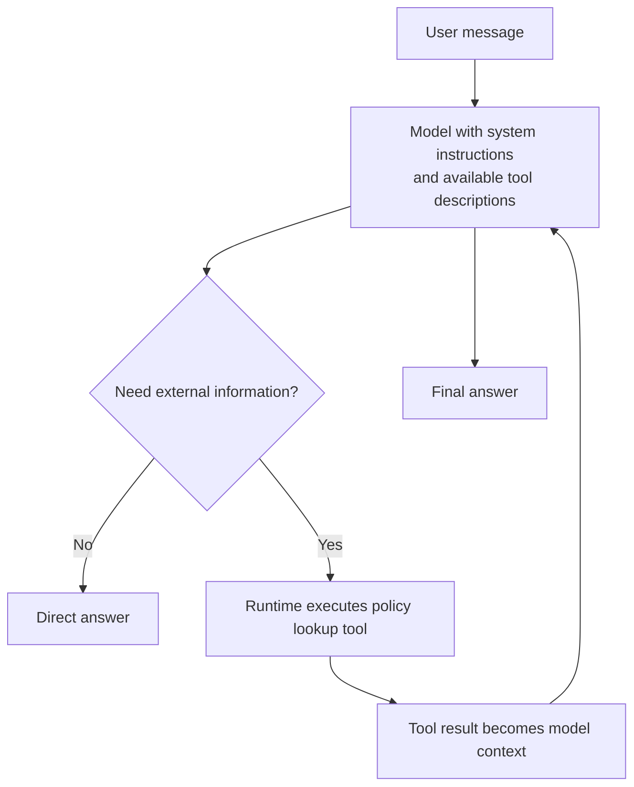
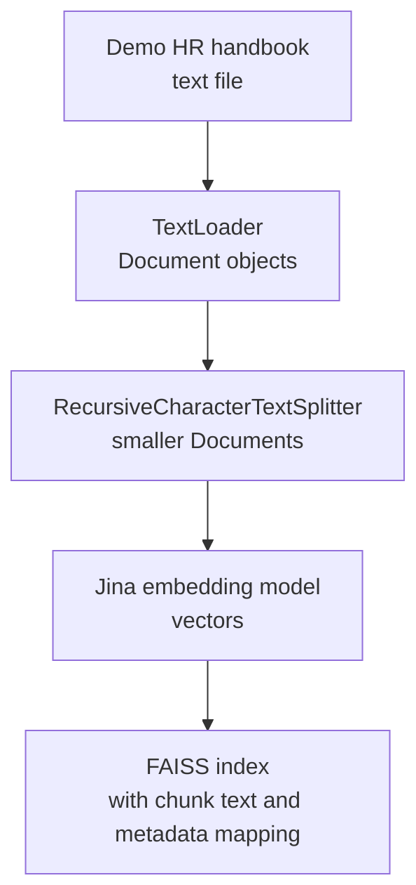

# Class 26: Building a LangChain RAG HR Assistant
### Production AI / LLM Engineering | Krish Naik Academy

**Mentor:** Divesh Jadhwani  
**Duration:** 3 hours 17 minutes 5 seconds | **Session:** Class 26 - 25 October 2026  
**Recording:** [25 Oct Langchain](https://learn.krishnaikacademy.com/web/courses/6a16f8935e281281cd6b1128?chapter=6ade6ba859c2d21580c9c6a3)

---

## Quick Updates

This class turns the previous session's RAG concepts into an **HR-policy question-answering notebook**. After revising fine-tuning, messages and tool use, Divesh builds the ingestion pipeline, tests retrieval, wraps it as an agent tool, and generates answers grounded in a sample handbook. The final attempt to add conversation memory remained unresolved during the live demonstration; the working retrieval assistant and that unfinished extension are kept distinct below.

The class repository is [d-hackmt/adv-batch-langchain](https://github.com/d-hackmt/adv-batch-langchain). Its main materials are `rag.ipynb`, `requirements.txt`, the demo `data/hr_policy.txt`, and the handwritten resources under `NOTES/`. The code excerpts below come from the supplied notebook, including its successful model initialization and the relevant debugging differences. Saved outputs are evidence from the instructor's run, rather than new executions performed for these notes.

Divesh recommended watching the first walkthrough before reproducing it independently. He also assigned the linked [Fine-tuning, RAG and Hybrid artifact](https://claude.ai/artifact/ARzxd2gJcNYEKojXiDhr65) as supplementary study. It is a scripted, fictional demonstration, not a live benchmark or an independently validated comparison of model accuracy.

---

## Revisiting Fine-Tuning: Learn a Behavior or Retrieve a Fact?

Divesh opened with a customer-support scenario: a company wants a chatbot that responds in the style of its employees. Historical support conversations can supply examples of questions and desired answers. In supervised fine-tuning, those examples continue the training of a pretrained model so its responses better match the desired task or behavior.

The example emphasized selecting some layers to retrain. That is one adaptation strategy, rather than the definition of all fine-tuning: full fine-tuning can update the base model broadly, while partial or parameter-efficient approaches update a subset or additional adaptation parameters. The data still needs preparation and evaluation. Giving a model employee conversations does not automatically make all organizational facts accurate, current or retrievable.

Two limitations motivated the return to RAG:

| Concern | Implication for the application |
|---|---|
| Training and retraining require resources | Frequent policy changes need an update strategy beyond repeatedly running a training job |
| Learned facts can become stale | A model does not automatically acquire information created after its training or adaptation data was collected |

The classroom story used an imagined early-LLM adoption period to introduce these choices. Treat it as a design progression, rather than a literal timeline in which RAG or model APIs first appeared in 2023. The original [RAG research paper dates to 2020](https://arxiv.org/abs/2005.11401).

RAG supplies selected external information **at inference time**, without requiring a parameter update for each document change. Fine-tuning and retrieval can also be combined: one concerns learned behavior or capability, while the other supplies evidence for the current query. Neither guarantees correctness without checking the data, retrieval and generated answer.

---

## From a Chat Model to a Tool-Using Agent

Divesh's revision diagram separates three components: the model as a “brain,” memory as conversation context, and tools as ways to obtain information or perform operations. A model call takes input and returns output. An application can preserve a conversation by storing previous messages and supplying appropriate history on later calls.

The shopping example made tool use concrete. A website might already have a backend function that filters products below a given price. Instead of triggering that function only from a button, an LLM can propose structured arguments based on a natural-language request. The application then validates and executes the function, receives its result, and gives the result back to the model.

The model does not directly execute an arbitrary Python function merely because it can describe one. The surrounding runtime exposes a tool, interprets the model's tool call, runs the implementation and returns the result. The function's name, parameter schema and description help the model choose when and how to use it.

For the HR example, “Hi” may need a direct greeting, whereas “Tell me the refund policy” needs a policy lookup. This is the reason-and-act loop represented in the revision image:



A model with stored chat history is not automatically an autonomous agent. In this class, the agent distinction becomes concrete when the model can request the retrieval tool and continue after observing its result.

### Four message types

| Message type | Purpose in this class |
|---|---|
| Human/user message | The user's question or follow-up |
| System message | Instructions defining the assistant's role and behavior |
| AI/assistant message | A model response, including a possible tool-call request |
| Tool message | The result returned by a tool execution |

These are roles, not a mandatory four-item sequence for every turn. A tool interaction usually has an AI message requesting a tool call, a matching tool result, then another AI response. A simple reply can have no tool message. System instructions may be assembled for each model request without being stored as a new item in every conversation turn. The official [message guide](https://docs.langchain.com/oss/python/langchain/messages) distinguishes these roles and their content and metadata fields.

Memory here means application-managed context. It is distinct from caching a previous response or reusing model computations. Short-term and long-term memory were mentioned, but the implementation at the end only attempted thread-level conversation history.

---

## RAG Has an Ingestion Side and a Retrieval Side

Divesh summarized RAG as a way to ask questions about external text. The handwritten notes divide it into two workflows:

1. **Ingestion:** load source content, split it, embed the chunks and index them.
2. **Retrieval and generation:** find relevant content for a question, then give the question and selected evidence to the model.

In a managed knowledge-base application, ingestion is usually a backend process. In an upload-based application, the user can trigger that process by supplying a file. The distinction concerns when and why the work happens, rather than a prohibition on users initiating ingestion.

The course-site chatbot was used as a visible example: questions about courses produced links to course pages. Divesh explicitly said he had not inspected its implementation. Its observed interface illustrates the desired behavior, but does not prove whether its backend scrapes every page live, reads a prebuilt index, queries structured data or combines these approaches.

The practical ingestion sketch uses this exact stack:



### A fixed retrieval pipeline versus retrieval as a tool

The PDF first shows a fixed flow: question, query embedding, top-k search, context plus instructions, model answer. Every query goes through retrieval in that particular design, even a greeting.

Its second sketch gives retrieval to the model as a tool. The model can choose a direct response or a search, and can formulate the search query. The practical uses this second form through LangChain's `create_agent`.

This is an architectural choice, rather than a strict rule that LangChain must search every time and only LangGraph can retrieve conditionally. LangChain agents support tool selection and use LangGraph infrastructure; LangGraph also permits more customized state and control flow. The official [retrieval guide](https://docs.langchain.com/oss/python/deepagents/retrieval) distinguishes fixed two-step RAG and agentic retrieval.

---

## Project Setup and the Roles of the Packages

Divesh created a virtual environment, selected a notebook kernel, installed the requirements and kept credentials in an environment file. The repository README's installation command is:

```bash
pip install -r requirements.txt
```

The relevant package groups are:

| Package | Role in the notebook |
|---|---|
| `python-dotenv` | Load environment variables from an environment file |
| `langchain` | The agent-building interface, including `create_agent` |
| `langchain-core` | Shared model, message, document and runnable interfaces |
| `langchain-community` | The demonstrated TextLoader, Jina and FAISS integrations |
| `langchain-groq` | Groq chat-model integration |
| `langchain-text-splitters` | Recursive character splitting |
| `faiss-cpu` | Local vector-search library |
| `jupyter`, `ipykernel` | Notebook interface and kernel support |

The imports used for ingestion are:

```python
from langchain_community.document_loaders import TextLoader

from langchain_text_splitters import RecursiveCharacterTextSplitter 

from langchain_community.embeddings import JinaEmbeddings
```

The requirements are **unpinned**, so they do not record a reproducible set of library versions. Package names and namespaces evolve. In particular, `langchain-classic` contains legacy functionality moved out of the main package; it should not be assumed to be a drop-in replacement for every direct `langchain-community` integration. Use the [official migration guide](https://docs.langchain.com/oss/python/migrate/langchain-v1) when adapting imports rather than relying on the speculative deprecation dates mentioned during class.

### Credentials and provider names

The notebook loads variables, then reads the two key names:

```python
groq_key = os.getenv("GROQ_API_KEY")  # LLM 
jina_key = os.getenv("JINA_API_KEY")   # EMBEDDING MODEL

print("ENV VAR LOADED")
```

The class also imports `load_dotenv` and calls `load_dotenv()` before these lines. The printed status is a progress message; it does not by itself prove that both keys exist or are valid.

The repository excludes `.env` and the demonstrated environment directory from Git. Do not paste key values into the notebook or its saved outputs. The code excerpts here use variable names and environment lookups only.

The provider is **Groq**, not xAI's Grok. Groq hosts the `gpt-oss` models used in the notebook; this is not access to an OpenAI-hosted proprietary GPT endpoint through the same account. **Jina** supplies the embedding service in this example. FAISS runs locally, but using hosted Jina and Groq APIs means the full application is not offline: document text is sent for embedding, and retrieved context is sent for generation.

Free trials and account limits were the instructor's reason for choosing these services for practice. They are not a promise of unlimited use or free production deployment.

---

## Load the Demo Handbook into Documents

The sample file contains eight policy sections: leave, work from home, probation, notice period, reimbursement, code of conduct, holidays and exit. It is fictional demo content, not the Academy's employment policy.

The path and loader appear in the notebook as:

```python
DATA_FILE_PATH = os.path.join("data" , "hr_policy.txt")
```

```python
loader = TextLoader(DATA_FILE_PATH , encoding="utf-8")
documents = loader.load()
```

The loader **decodes** the file using UTF-8 and returns a list of LangChain `Document` objects. It does not return a `TextLoader` instance as the loaded data, and it is not converting the input file into UTF-8 by changing its encoding on disk.

The saved output shows **one loaded document containing 2,603 characters**. Useful inspection points are:

| Expression | What it reveals |
|---|---|
| `len(documents)` | Number of loaded document objects |
| `documents[0].page_content` | Text in the first document |
| `documents[0].metadata` | Associated information, including its source path |

Here the metadata identifies `data/hr_policy.txt`; the saved Windows output uses backslashes in that path. Different loaders can attach other metadata, such as page or source identifiers. A `Document` is a standardized container for this text-processing workflow, not a claim that every LangChain component always operates only on documents. Chat models use messages, for example.

### The attempted multiple-file shortcut did not work

During the demo, Divesh copied the text file and tried to adapt the single-file loading code to several paths. That experiment produced a problem, and he returned to the original one-file pipeline. It was not a successful demonstration of bulk loading.

For multiple formats, select an appropriate loader, then standardize the extracted text and metadata. PDF and text sources can enter the same downstream document workflow, but parsing still matters: scanned pages, tables, headers and layout need suitable extraction. The class browsed alternative loaders, including web and PDF loaders; it did not implement those integrations.

Source metadata helps provenance, but it is not automatically visible to the model merely because it exists in a `Document`. The retrieval tool later joins only `page_content`, so its return string omits metadata unless the tool is extended to include it.

---

## Chunking: Size, Overlap and Separator Priority

The next step is to make pieces that can be retrieved individually. Divesh first demonstrated a three-rule string with `chunk_size=60` and `chunk_overlap=10`. The saved result contained one chunk per rule because the newline boundaries and rule lengths permitted that division.

The handbook uses:

```python
text_splitter = RecursiveCharacterTextSplitter(
    chunk_size = 500,
    chunk_overlap=50
)

chunks = text_splitter.split_documents(documents)
```

With the default character-count length function, **500 means characters**, not tokens or words. The splitter tries separator levels in order. The standard hierarchy is double newline, newline, space and finally an empty separator, which allows character-level splitting when necessary. This is a deterministic text-splitting heuristic, not a language model understanding paragraph meaning.

The official [recursive-splitting reference](https://docs.langchain.com/oss/python/integrations/splitters/recursive_text_splitter) describes `chunk_size` as the maximum under the selected length function and `chunk_overlap` as a target. It does not promise every split ends at a full stop. A full-stop separator is not even in the default list.

### What overlap is trying to preserve

If a useful statement crosses a chunk boundary, an overlap can carry some surrounding context into the next piece. That helps retrieval avoid receiving only half of a fact. It also repeats content, increasing storage and potentially the amount of duplicated context later retrieved.

Overlap is configurable and **may be zero**. The actual retained overlap can be smaller than the target because the algorithm works with the selected separators and merge boundaries. Do not expect exactly 50 repeated characters between every pair of the handbook's chunks.

The live parameter changes produced these counts:

| Chunk size | Target overlap | Reported chunks |
|---:|---:|---:|
| 500 | 50 | 9 |
| 600 | 60 | 6 |
| 300 | 20 | 14 |

These counts apply to this input and splitter configuration. They are not formulas for other corpora. Returning to 500/50 yielded nine chunks: the short handbook heading and its eight policy sections. Each result remains a `Document`, carrying its text and source metadata.

Divesh inspected the heading, work-from-home and code-of-conduct chunks to show the actual boundaries. This is a useful habit: look at what a splitter produced rather than assuming the requested size guarantees meaningful pieces.

### Choosing a chunk size

The class treated chunk selection as experimentation informed by the content. FAQs, long prose, source code and extracted PDF text have different structures. Evaluate whether retrieved chunks contain enough evidence to answer representative questions without excessive unrelated text.

The closing Q&A also explicitly connected chunking to the model's context window. Earlier remarks that context size need not be considered should not be generalized. Instructions, history, tool definitions, retrieved content and room for output all consume the available budget.

For example, **ten chunks of 4,000 characters total about 40,000 characters** before formatting and other context. That is not automatically 40,000 words or 40,000 tokens. Use the relevant tokenizer or a documented approximation when planning model requests. Processing a PDF in batches of pages is one ingestion tactic; the class's “15 pages” suggestion is not a universal chunking standard.

Cleaning also remains useful. A model's ability to interpret imperfect text does not remove the need to fix broken extraction, duplicated headers, missing content or incorrect metadata before indexing.

---

## Embeddings: A Different Job from Text Generation

An embedding model converts text into a vector used for comparison and search. A chat model generates a response. Their roles are separate even if both are neural models.

The notebook initializes the embedding model with:

```python
from langchain_community.embeddings import JinaEmbeddings

embeddings_model = JinaEmbeddings(model_name="jina-embeddings-v2-base-en")
```

Divesh selected the English v2 model while browsing Jina's available models. The demo query is:

```python
query_vector = embeddings_model.embed_query("What is LangChain?")

query_vector
```

Its saved output is a vector of **768 numbers**. Printing an entire vector makes the representation visible, but the useful operational checks are its dimension, type and compatibility with the index.

The model's [official card](https://huggingface.co/jinaai/jina-embeddings-v2-base-en) describes an English embedding model supporting inputs up to 8,192 tokens. That input limit and the 768-dimensional output are different properties. Neither is the model's parameter count.

The handwritten examples compare vector widths from different providers. Read those as illustrations that dimensions vary, not fixed dimensions for every Google, OpenAI or Hugging Face model. A larger output vector is not sufficient evidence that an embedding model is better or more expensive. Measure retrieval quality on the intended language, domain and query types.

Jina and Qdrant are also not competing layers in this specific comparison: Jina supplies embeddings, while Qdrant is a vector-database option. FAISS, Pinecone, Qdrant, Elasticsearch and other stores were mentioned as alternatives, but no comparative benchmark was performed.

When changing embedding models, document and query vectors must remain compatible. A matching vector length alone does not prove they share a useful semantic space. Existing documents generally need to be re-embedded when the embedding model or its relevant configuration changes.

---

## Build the FAISS Index and Test Retrieval Before Adding an Agent

The notebook imports FAISS, then builds the store from the chunks and embedding model:

```python
from langchain_community.vectorstores import FAISS 
```

```python
vector_store = FAISS.from_documents(chunks , embeddings_model)
```

This convenience call obtains document embeddings and builds the local search structure. The LangChain wrapper also maintains the mapping back to the original chunk text and metadata. The model receives text later; it does not answer a policy question by interpreting the raw floating-point array itself.

The count check is:

```python
print("CHUNKS ARE STORED" , vector_store.index.ntotal)
```

The saved result is **9**. This verifies the index contains nine vectors in the demo. It does not establish that a persistent database file has been saved. The notebook creates an in-process index and does not call a disk-persistence method.

FAISS is a similarity-search library. The simple local wrapper is convenient for learning, while a production store may also need persistence, concurrent access, metadata filtering, access control and update operations.

### The sick-leave query

The notebook's retrieval test is:

```python
test_query = "How many sick leaves employees get"
```

```python
top_matches = vector_store.similarity_search(test_query , k=3)
```

This embeds the query and retrieves up to three matching documents. The first saved result is the leave policy, which says employees receive **10 paid sick days per year**, separately from annual leave. The other saved results are holidays and notice period.

This question asks for an entitlement in the demo handbook. “How many sick days do I personally have left?” would additionally require an employee-specific balance; a generic policy document cannot supply that fact.

Although cosine similarity was used in the conceptual revision, the notebook does not explicitly configure cosine search. The demonstrated LangChain FAISS construction defaults to an L2 index in the [official implementation](https://github.com/langchain-ai/langchain-community/blob/main/libs/community/langchain_community/vectorstores/faiss.py). Cosine, inner product and L2 have relationships under appropriate normalization, but they should not be labeled interchangeably without checking the configuration. See [FAISS's metric documentation](https://github.com/facebookresearch/faiss/wiki/MetricType-and-distances).

### A useful failed ranking prediction

Divesh inserted the word “sick” into the notice-period text to demonstrate how changed content can affect retrieval. He predicted that notice period would become the second result. It appeared **third** in the shown result, and the supplied file retains the phrase “last working sick day.”

That sequence is more instructive than a claim that adding a keyword guarantees a rank. Dense retrieval is not simply counting occurrences of a term. Text edits can influence an embedding and ranking, but the result depends on the full query, chunk and model. A loosely related result can still enter top-k even when the most relevant chunk ranks first.

After changing source text, the live notebook reloaded, split, embedded and rebuilt the store. Editing a file alone does not magically update vectors already in memory. Incremental updates were discussed later, but were not implemented here.

This stage tests retrieval separately from generation. The embedding service is already a learned model; “no AI yet” in the narration means no generative chat model has yet answered the question.

---

## Turn Retrieval into a Tool

After the break, Divesh made the vector search available to the assistant. The exact notebook function is:

```python
retriever = vector_store.as_retriever(search_kwargs={"k": 3})  # returns top 3 relevant chunks


def search_hr_policy(question:str)->str:
    """
    Search the HR policy document for information about leave, work from home,
    probation, notice period, reimbursement, code of conduct, holidays, or exit process.
    
    """
    matching_chunks = retriever.invoke(question)
    return "\n\n".join(chunk.page_content for chunk in matching_chunks)
```

The retriever is an interface around the store's search behavior. Calling it with a question produces matching `Document` objects. The function joins their contents into a string for the model to read.

Three details matter:

- The type annotation describes the question input and string result.
- The docstring describes the knowledge the tool can search, guiding tool selection.
- The fixed `k=3` belongs to the retriever configuration. The model supplies the question here, rather than freely choosing `k` through this function's signature.

`create_agent` can accept a plain Python callable with a suitable schema and description, so this example does not add a decorator. The runtime turns the callable into a tool interface. A meaningful name and description improve discoverability, but do not guarantee the model always chooses or uses the tool correctly.

Only chunk text is returned by this implementation. The metadata used for source inspection is not included in the joined result, and the function does not enforce document permissions, version filters or citations.

---

## Initialize Groq: Preserve the Debugging Distinction

Divesh first tried a model construction that retained the string `groq:openai/gpt-oss-120b` inside `ChatGroq`. The saved notebook also contains that early configuration with `temperature=0.5`, while the live narration initially described zero. It then reassigns `llm` with the successful direct-provider construction:

```python
from langchain_groq import ChatGroq
llm = ChatGroq(model="openai/gpt-oss-20b")
llm.invoke("Say hi").content
```

The saved response is a greeting, and subsequent response metadata identifies **`openai/gpt-oss-20b`**. Therefore the working assistant should not be reported as a successful 120B run.

There are two naming layers:

| Interface | Model-name pattern discussed |
|---|---|
| Direct `ChatGroq` constructor | Groq's model identifier, such as `openai/gpt-oss-20b` |
| Provider-routing `init_chat_model` interface | A provider-qualified identifier can include `groq:` |

The prefix belongs to the routing interface, rather than automatically being part of the provider's own model ID. The official [ChatGroq integration](https://docs.langchain.com/oss/python/integrations/chat/groq) and [Groq model documentation](https://console.groq.com/docs/model/openai/gpt-oss-20b) establish the direct integration and provider identifier.

The live error prompted an API-key check, a new key and changes to model initialization. A model-not-found or access error does not by itself prove the key was invalid. Check the exact provider, model ID, access and environment state before assigning one cause. Notebook cells also retain state: rerunning an earlier constructor can overwrite the working `llm` variable.

A lower temperature was described as limiting variation, not as a guarantee of correctness or deterministic execution. The final successful constructor above does not explicitly set the temperature, so do not silently replace its value with the earlier spoken setting.

---

## Inspect the Plain Model Response Before Using Retrieval

Divesh asked the bare chat model about code of conduct before attaching the retrieval tool:

```python
answer = llm.invoke("tell me about code of conduct")
```

```python
print(answer.content)
```

The model returned a long general explanation. That is not evidence it had read the Acme handbook. This comparison establishes why the next step must supply external context rather than assuming a fluent answer is organization-specific.

A chat-model invocation returns an **AIMessage**, not an ordinary dictionary with arbitrary attributes. The successful inspection in the notebook is:

```python
answer.response_metadata
```

The stored metadata includes the model name, token usage, timing and finish reason. Its example contains 77 prompt tokens and 1,600 completion tokens, totaling 1,677. These are details of that recorded call, not a standard cost or speed for all queries.

Use the documented fields: `content` for the response content, `response_metadata` for provider response information, and `usage_metadata` when supplied for normalized token usage. The live attempts to access fields such as a top-level model name or generic `.metadata` should not be copied as working API examples. Metadata keys and availability can vary by integration.

This was an inspection of available response information. Exporting it to an observability platform was mentioned, but a LangSmith tracing integration was not configured in this notebook.

---

## Create the HR Agent and Read Its Tool Trace

The assistant combines a model, a tool list and instructions. This is the structure drawn on the PDF's final page. The notebook's first assistant construction is:

```python
hr_assistant = create_agent(
    model = llm,
    tools=[search_hr_policy],
    system_prompt= """ 
    
    You are a friendly HR assistant working for Acme Crop. 
    Always use the search_hr_policy tool to look up 
    facts before answering. 
    If the answer isn't in the search results, say you don't know "
    instead of guessing."
    
    always reply in 2 lines , if you are not clear ask a questions to clarift from user
    
    Dont entertain any other questions which are off topic and if you dont understand ,
    tell that mail to acmecorp.com
    """,
    
)
```

The notebook imports `create_agent` from `langchain.agents` beforehand. The excerpt preserves the supplied prompt, including its spelling and punctuation. “Acme Crop” is a typo relative to the demo document's Acme Corp; the domain text is a fictional fallback, not an instruction to email anyone.

The intended behaviors are to retrieve HR facts, avoid guessing, keep answers brief, clarify ambiguous questions and stay within scope. These are prompt instructions, not enforced access controls or a validated guardrail system. The saved long answers also do not demonstrate reliable compliance with the later two-line instruction: notebook outputs can remain after source edits, and this construction cell has no saved execution count.

The invocation format is:

```python
response = hr_assistant.invoke({"messages": [{"role": "user",
                            "content": "tell me about code of conduct"}]})
```

Here the caller passes a user-role message because it is submitting the user's question. Dictionary-format messages use `assistant` for model output, while LangChain's corresponding object is `AIMessage`; system and tool messages have their own roles and requirements. They are not interchangeable labels for the same external input.

### What the saved trace shows

The returned agent state contains a `messages` list:

1. A human message asking about code of conduct.
2. An AI message with a tool call to `search_hr_policy`, using the question “code of conduct.”
3. A tool message containing the three retrieved chunks.
4. An AI message producing the final answer from that context.

The returned tool call and tool result share a call identifier. The first AI message can have empty text content while still carrying a valid tool request. Two AI messages in the trace are explained by the tool-call step and the final response; they are not proof that every model's private reasoning is exposed as a separate message.

The saved output includes provider-specific reasoning content, but that is specific to this model and response format. Do not assume every model or API supplies the same field.

The source retrieves the final answer with:

```python
print(response["messages"][-1].content)
```

The agent invocation returns state, while the earlier bare model invocation returned an AIMessage. This is why the access patterns differ. `[-1]` selects the last message in this demonstrated response, `[0]` selects its initial user message, and another index can select an intermediate tool message. These indices describe this trace; more tool steps would change the intermediate positions.

### The visible policy answers

The grounded code-of-conduct answer covered professionalism, respect, prohibited misconduct and annual training. The probation question produced the handbook's three-month period, lack of paid-leave eligibility during probation, emergency unpaid leave with approval, and the shorter probation notice period.

Those answers illustrate the completed RAG path. They are still generated answers that need checking against the retrieved text. The demo did not measure retrieval recall, groundedness, task accuracy or resistance to malicious documents across a test set.

---

## Conversation Memory: Added in Code, Unresolved in the Demo

The first helper invoked the agent with only the current question. When asked “tell me about that policy,” it requested clarification. Asked “what did I ask,” it could repeat the current question rather than recall the earlier exchange. No cross-call history had been configured in that first version.

Divesh then consulted the documentation and added a LangGraph checkpointer. The notebook imports:

```python
from langchain.agents import create_agent
from langgraph.checkpoint.memory import InMemorySaver
```

The later `create_agent` call retains the model, tool and HR prompt and adds the argument `checkpointer=InMemorySaver()`. Its conversation configuration is:

```python
config = {"configurable": {"thread_id": "user-session-1"}}
```

A subsequent source call passes that configuration:

```python
response = hr_assistant.invoke(
    {"messages": [{"role": "user", "content": "what was my last question"}]},
    config=config,
)
```

A **thread ID is a logical conversation identifier**, not a Python operating-system thread that must be started. A checkpointer stores agent state associated with that identifier; later invocations reuse the same agent/checkpointer and thread ID to continue the conversation. The official [short-term-memory guide](https://docs.langchain.com/oss/python/langchain/short-term-memory) documents that pattern.

However, **the live follow-up did not succeed as intended**. The assistant continued to refuse the “last question” request and directed the user toward the fictional company contact. Divesh considered the off-topic instruction or possible reinitialization as causes and explicitly left the behavior for later investigation. The saved notebook retains the refusal.

A refusal does not alone prove the checkpointer stored nothing: prompt behavior and state persistence are separate things to inspect. Conversely, adding the checkpointer argument is not evidence that the demonstration successfully validated memory. The later “How many days do I get?” follow-up was ambiguous after a code-of-conduct question and elicited a clarification; it is not a clean memory test either.

### In-memory state and production sessions

`InMemorySaver` stores state in the current process. Restarting the kernel or process loses that storage, and constructing a fresh saver creates a separate state store. A browser interface is not what makes it durable.

Nitin's closing questions connected this to saved conversations in a chat sidebar. Applications can associate multiple conversation IDs with a user and persist checkpoints in a database. A database-backed saver, together with application identity and ownership checks, can support resuming a conversation later. A hard-coded thread ID is not a user-isolation or authorization mechanism.

Checkpoint storage and the document vector index are different stores with different jobs. SQL/PostgreSQL was discussed for persistent conversations; vector-database choices were discussed separately for document retrieval. Neither must contain exactly the same data as the other.

---

## Production Questions Raised by the Small Demo

The class finished with production-oriented questions. These were discussion points and future extensions, not features completed in the notebook.

### Token cost and corpus size

Gaurav Kumar asked how a very large uploaded knowledge base affects user-level token cost. The useful distinction is that the generation model normally receives the **retrieved context**, not every stored document. Increasing the corpus does not automatically place the full corpus in every generation prompt.

But a small `k` is not a complete cost control. Account for document embedding during ingestion, query embeddings, instructions, history, tool schemas, returned tool text, output tokens and potentially multiple model calls in the agent loop. Indexing and storage also have costs. Three long chunks can exceed the desired budget just as ten short ones may fit.

The implementation fixes retrieval to three chunks but adds no per-user quota, request budget or output cap. Such limits require explicit configuration and application logic.

### Updating only changed content

Nitin asked whether new and modified documents require re-indexing everything. Divesh proposed watching for changes, identifying the affected content and replacing the corresponding indexed data through custom functions.

That is a design direction, not implemented incremental indexing. Useful update information can include source identity, version, timestamps and stable chunk IDs. If content changes, the relevant text/vector must be updated; merely changing a timestamp beside an old embedding does not update its semantic representation. A text edit can also move neighboring chunk boundaries, so “replace exactly one chunk” is not guaranteed for every splitting strategy.

### Version metadata versus version enforcement

Earlier, Divesh suggested storing dates and instructing the assistant to prefer the latest policy. Metadata is useful only if the retrieval or prompt path actually uses it. The current `search_hr_policy` return value contains no timestamp or version metadata.

Filtering active versions, replacing stale entries and handling deletions are application/index responsibilities. A prompt saying “use the latest” cannot retrieve a missing update or guarantee an obsolete policy is excluded.

LangSmith dataset versioning also came up during a documentation search. Its [versioned datasets](https://docs.langchain.com/langsmith/manage-datasets) support evaluation examples and experiments. That is different from automatically watching a production HR folder and synchronizing its FAISS index.

### Long conversations and summarization

Nitin asked whether the checkpointer automatically handles growing context. It stores state; it does not automatically turn an unlimited conversation into a short prompt. Long histories can increase cost, exceed the model's context window or dilute relevant information. There is no universal failure threshold of 20 or 30 questions.

Divesh introduced summarization middleware as a possible solution. It must be configured: the class's example of summarizing ten messages before an eleventh was an illustration, not an automatic behavior in the notebook. The official [middleware guide](https://docs.langchain.com/oss/python/langchain/middleware/built-in) documents configurable summarization triggers and retained context. Trimming, summarizing and selecting relevant history also involve information tradeoffs.

### Authorization and guardrails were not solved

A chat question asked how one group's documents can be hidden from another group. The instructor said the question was unclear and did not implement an answer. Nitin also briefly asked about guardrails before the conversation moved to memory. That question did not receive a substantive guardrail design.

The supplied agent prompt is therefore not evidence of group-based access control, injection protection or production security. These remain separate requirements to design and verify. Likewise, the vendor names mentioned in Q&A are examples, not a benchmark proving one vector store is always best.

---

## What's Next

Divesh said the following class would continue LangChain in more depth and add further techniques. The conversation-memory behavior was explicitly left for later checking. A versioning example was promised, but no practical implementation appeared in this session.

Semantic chunking, other splitting strategies, streaming, observability, evaluations, guardrails, gateways, a different vector store and deployment were mentioned as later material or as topics in a separate playlist. They should not be counted as completed features of this notebook.

The assigned [Fine-tuning, RAG and Hybrid artifact](https://claude.ai/artifact/ARzxd2gJcNYEKojXiDhr65) illustrates simple-RAG failures and a hybrid approach through a fictional shop scenario. Its scripted examples include confusing reward coins with gift cards, retrieving conflicting return-policy versions and mixing delivery locations with partner-store locations. The hybrid view illustrates learning evidence-use and refusal behavior while still using retrieved context. Its displayed percentages are not validated experimental accuracy, and fine-tuning plus RAG does not guarantee those failures disappear.

---

## Live Q&A Highlights

| Question | Answer |
|---|---|
| What data would teach a support assistant to reply like employees? | Prepared examples of customer questions and desired responses can support supervised adaptation. It does not automatically provide a complete, current organizational knowledge base. |
| Must fine-tuning retrain only the last few layers? | No. That was the revision example; full, partial and parameter-efficient adaptation are different choices. |
| Does each conversation turn require all four message types in a fixed order? | No. Roles depend on the interaction; a tool result follows the matching AI tool call, while a direct answer can use no tool. |
| Alok: must a system message be stored again in every turn? | Instructions need to be supplied appropriately to model requests, but that does not require duplicating a system-message item in every stored turn. |
| Ramak Krishna: is agent memory caching or short-term memory? | The explained buffer is conversation history. Caching and long-term memory are separate mechanisms. |
| Ashwin: what is a tool message? | It is the result returned by a tool, such as policy-search text or database results, rather than the tool-call request itself. |
| Are human and user messages different here? | They represent the same user-input role in the demonstrated workflow. |
| Must every LangChain query search the vector store? | Only in the fixed pipeline drawn for comparison. An agent can decide when to call a retrieval tool. |
| Can the question plus top-k context exceed the model's window? | Yes. Budget for instructions, history, tools, retrieved text and output; a small k alone does not guarantee fit. |
| Can RAG use images? | Multimodal RAG exists, but the practical here used a text handbook. |
| What do Groq, Jina and FAISS each do? | Groq hosts generation models, Jina supplies embeddings, and FAISS performs local vector search. They occupy different parts of the pipeline. |
| Is Jina better than Qdrant? | That compares different components: an embedding provider and a vector-database option. No head-to-head quality test was done. |
| Does a larger embedding dimension guarantee a better model? | No. Dimension is vector width, and retrieval quality depends on the model, data and task. |
| Is overlap mandatory? | No. It is a configurable target and can be zero; actual overlap depends on splitting boundaries. |
| Do we need to clean data before chunking? | Extraction and cleaning quality still matter. An LLM's tolerance for imperfect text does not repair missing or malformed indexed content automatically. |
| How do we load several text files? | The live shortcut failed and was reverted. The completed example loads one file; bulk loading was not successfully implemented. |
| What is a LangChain Document? | A standardized object containing page content and metadata for the document-processing workflow. |
| Will source metadata automatically reach the model? | No. This tool returns joined page content only; metadata must be deliberately exposed or used in retrieval filters. |
| Rahul: will embedding all chunks cause rate-limit problems? | Nine chunks worked in the demo, but provider request/token limits still apply to larger ingestion batches. |
| Is the retrieval test keyword search? | It uses dense-vector search. Editing a keyword can affect ranking, but does not guarantee a position. |
| Prathiba: what if unrelated chunks contain the same word? | Retrieval can return irrelevant or misleading context. The sick-word experiment illustrated imperfect ranking; it did not implement a remedy. |
| Why was notice period not second after adding “sick”? | It appeared third in the shown result. Dense retrieval depends on the full representations rather than a guaranteed term-count ordering. |
| Can a policy-only document answer my remaining leave balance? | It can answer entitlement rules; a personal remaining balance needs employee-specific data. |
| Why did the Groq model call fail? | The demo changed both model naming and model selection. The successful direct constructor used `openai/gpt-oss-20b`; the error did not establish that the key alone was the cause. |
| Gaurav: can we stream instead of invoke? | Streaming was acknowledged as an option, but not demonstrated as a completed implementation here. |
| How do we read the model output and metadata? | Use AIMessage fields such as `content`, `response_metadata` and available `usage_metadata`, rather than assuming it is a plain dictionary. |
| Why are there two AI messages in the agent trace? | One requests the tool and a later one gives the final answer after the tool result. |
| Why does `response["messages"][-1].content` work? | This agent call returns state with a message list; the last message is the final answer in the shown successful trace. |
| Did the memory-enabled follow-up work? | Not as intended. Refusals persisted, and the instructor left the issue for investigation. |
| Is `thread_id` a Python thread? | No. It identifies a logical conversation whose state the checkpointer stores. |
| Does in-memory state survive a restart? | No. It belongs to the running process and saver instance; durable sessions need persistent storage. |
| Gaurav Kumar: does a huge corpus consume all its tokens on each answer? | Generation usually receives retrieved snippets, not the entire corpus. Ingestion embeddings, query embeddings, history, prompts, tool calls and generated output still affect cost. |
| Nitin Gupta: how can we index only new or changed content? | Divesh proposed a change watcher and replacement logic using source/metadata identities. No working delta-indexing pipeline was built. |
| Nitin Gupta: do we get automatic production versioning from LangSmith? | LangSmith versions evaluation datasets; that does not itself synchronize changed source documents into the production vector store. |
| Nitin Gupta: what should be included as guardrails? | This brief question was not substantively answered before the discussion moved to memory. The prompt alone is not a complete guardrail system. |
| Nitin Gupta: does the checkpointer automatically summarize long chats? | No. It stores state; summarization or trimming requires explicit configuration such as middleware. |
| Nitin Gupta: how do saved chat threads resume later? | Associate users and conversations with persisted state, then resume the correct thread. A database-backed checkpoint store and application ownership checks are needed for durable multi-user behavior. |
| Nitin Gupta: which database stores conversations? | SQL/PostgreSQL was discussed as a persistent option. Conversation storage and vector retrieval are different responsibilities. |
| Nitin Gupta: are Pinecone, pgvector and Elasticsearch valid options? | They were discussed alongside Qdrant and other stores. The class did not evaluate a universally best production database. |
| Mangesh Khandare: are there roles beyond `user`? | Yes: system instructions, assistant/AI responses and tool results have distinct roles. The notebook uses `user` because it is supplying a user's question. |
| Mangesh Khandare: will the linked playlist require subscriptions? | The instructor described a free-friendly learning path. Actual service quotas, infrastructure and production costs still need checking. |
| Sampath Kumar: how should chunk size and overlap be selected? | Use document structure, retrieval tests and the total context budget. Suggested page batches and character counts are examples, not universal constants. |
| Sampath Kumar: how can PDF and text sources be combined? | Appropriate loaders can produce standardized Documents for downstream processing. Preserve source metadata and combine or separate indexes according to the application. |
| Sampath Kumar: can sources be kept separate? | Yes, separate stores or database-supported collections are possible. The local FAISS example does not itself implement a collection-management service. |
| Sampath Kumar: is recursive splitting always the best production strategy? | No universal winner was established. Other word, sentence, structure or semantic strategies were mentioned; the final spoken recommendation is unclear in the captions. |
| How is one group's knowledge hidden from another? | The question was raised but not resolved in the class. Retrieval permissions were not implemented. |

---

## Key Pointers to Remember

- Ingestion creates the searchable knowledge base; retrieval selects evidence for a particular question.
- The class's completed result is a notebook HR-policy assistant, with conversation memory still under investigation.
- TextLoader returns Documents with text and metadata; it does not solve arbitrary multi-file ingestion by receiving several paths at once.
- Recursive character splitting uses separator priorities and character lengths, not semantic understanding or token counts.
- A target overlap is optional and need not appear as exactly that many repeated characters at every boundary.
- The demonstrated 500/50 split produced nine chunks for the supplied handbook.
- Jina generated 768-dimensional embeddings; vector dimension is not model size or a quality guarantee.
- Local FAISS does not make remote embedding and generation calls local.
- The notebook's FAISS configuration should not be described as explicitly using cosine similarity.
- Top-k results can include distractors. Inspect retrieval before trusting a fluent generated answer.
- The successful working model variable was reassigned to Groq's `openai/gpt-oss-20b`.
- AIMessage output and agent state are different return types with different access patterns.
- A retrieval tool's docstring describes its function; the application runtime executes it.
- Stored metadata does not help a model unless the retrieval or prompt path actually uses it.
- A checkpointer stores thread state; summarization, authorization and durable multi-user storage require additional configuration.
- Corpus size, retrieval size, prompt size, embedding cost and output cost are related but distinct quantities.

---

## Action Items After Class 26

- [ ] Read the repository README, requirements and demo handbook before reproducing the notebook.
- [ ] Keep API credentials in environment variables and verify the selected notebook kernel uses the intended environment.
- [ ] Inspect the loaded Document's content and metadata, then compare the 500/50 chunk boundaries with the other demonstrated settings.
- [ ] Test retrieval questions directly and check that the relevant handbook section appears before adding generation.
- [ ] Compare a plain model response with the agent's tool-grounded answer; inspect the tool-call and tool-result messages.
- [ ] Review the successful Groq model identifier and avoid accidentally rerunning the earlier failed constructor over the working variable.
- [ ] Treat the memory attempt as unfinished: inspect persisted state separately from refusals, reuse one thread/saver, and use an unambiguous in-scope follow-up when testing.
- [ ] Estimate a full request budget, including history, tools, retrieved context and output, rather than counting chunks alone.
- [ ] Study the assigned fictional fine-tuning/RAG/hybrid artifact without treating its scripted outcomes as measured accuracy.
- [ ] Keep incremental ingestion, version enforcement, access control, guardrails and production deployment on the list of features still to implement and evaluate.

---

## Sources

The primary source is the [complete 25 October Class 26 recording and transcript](https://learn.krishnaikacademy.com/web/courses/6a16f8935e281281cd6b1128?chapter=6ade6ba859c2d21580c9c6a3), original filename **GMT20261025-142043_Recording.cutfile.20261025204943202.transcript.vtt**.

The matching course-linked materials are the [repository README](https://github.com/d-hackmt/adv-batch-langchain/blob/main/README.md), the complete [rag.ipynb](https://github.com/d-hackmt/adv-batch-langchain/blob/main/rag.ipynb), [requirements.txt](https://github.com/d-hackmt/adv-batch-langchain/blob/main/requirements.txt), [demo handbook](https://github.com/d-hackmt/adv-batch-langchain/blob/main/data/hr_policy.txt), all five pages of [Scribble notes.pdf](https://github.com/d-hackmt/adv-batch-langchain/blob/main/NOTES/Scribble%20notes.pdf), and the [revision diagram](https://github.com/d-hackmt/adv-batch-langchain/blob/main/NOTES/adv%20notes%20revision.png). Repository source was read in full for the supplied notebook; the live sequence and saved outputs are distinguished where they differ. Official documentation is linked beside the claims it clarifies.

*Notes compiled from the full Class 26 transcript, matching notebook, demo data and handwritten diagrams - “Building a LangChain RAG HR Assistant,” Production AI / LLM Engineering, Krish Naik Academy.*
